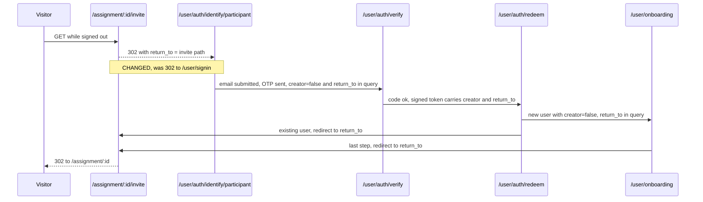

# Invite links send signed-out visitors to the participant entry page

| | |
|---|---|
| Status | Built and verified locally |
| Issue | [Core: send signed-out invite visitors to the participant entry page](https://app.basecamp.com/5734045/buckets/35926565/todos/10389229971) |
| Use case | [UC-SENSE-04: Create an account or sign in from an invitation and continue to the assignment](https://app.basecamp.com/5734045/buckets/35926565/todos/10268628456) |
| Depends on | [UC-NEXT-03 participant entry point](https://app.basecamp.com/5734045/buckets/35926565/todos/10255424847) (`/user/auth/identify/participant`) |
| Related | iOS counterpart: "iOS: participant sign-in and onboarding from an invitation" (10389229987) |
| Branch | `feat/uc-sense-04-invite-participant-entry` |

## Problem

A signed-out visitor who opens an assignment invitation link in a browser is sent to
`/user/signin`, the generic sign-in page. Invited visitors are participants, so they
should land on the participant entry page from UC-NEXT-03 and continue to the
assignment after signing in.

This is the browser half of UC-SENSE-04 ("Entry in a browser" in the UC's technical
approach). The app half opens the invite only after sign-in and is not affected.

## Requirements

Each requirement traces to an acceptance criterion of the issue.

| ID | Requirement |
|---|---|
| R1 | Signed out, `GET /assignment/:id/invite`, `/apply` and `/join` redirect to `/user/auth/identify/participant?return_to=<invite path>`. |
| R2 | New email: email code, then onboarding profile steps, then the assignment. The account is created with `creator: false`. |
| R3 | Existing account: email code, then the assignment. The stored `creator` flag is unchanged. |
| R4 | Signed in: the invite link goes straight to the assignment, as today. |
| R5 | Every other route behind `:require_authenticated_user` still redirects to `/user/signin`. |

## Flow and current code

Target flow. Only the first redirect changes; today it points to `/user/signin`.

- Routes: `systems/assignment/_routes.ex:8-16` pipe `/invite`, `/apply`, `/join` through
  `[:browser, :require_authenticated_user, :assignment_exists]`.
- Guard: `Systems.Account.UserAuth.require_authenticated_user/2`
  (`systems/account/user_auth.ex:189-199`) stores `current_path` in session
  `:user_return_to` and redirects to `~p"/user/signin"`. There is no per-route
  override.
- `/user/signin` ignores `return_to`; the return path only survives through the session.
- The participant path already works end to end once the visitor starts on
  `/user/auth/identify/participant?return_to=...`:
  - `AuthIdentifyPage` sets `creator? = live_action != :participant`
    (`bundles/next/lib/account/auth_identify_page.ex:19`) and carries `return_to` and
    `creator` into the verify URL (`:105-109`).
  - `AuthCodeVerifyPage` signs both into the redeem token
    (`bundles/next/lib/account/auth_code_verify_page.ex:60-72`).
  - `SessionController.redeem_otp` registers new emails with the token's `creator?`
    (`bundles/next/lib/account/session_controller.ex:114`) and stashes `return_to` in
    the session (`:131-134`).
  - `UserAuth.log_in_user/4` sends first-time users to
    `/user/onboarding?return_to=...` and existing users to `return_to`
    (`systems/account/user_auth.ex:38-43`).
  - `OnboardingPage` finishes at `return_to`.
  - `Assignment.Controller.participate/2` adds the participant and redirects to
    `/assignment/:id` (`systems/assignment/controller.ex:39-60`, `:272`).

## Design

Only the redirect target of the guard changes for the three invite routes. Identify,
verify, redeem, `log_in_user` and onboarding are untouched, which matches the UC
constraint "no changes to auth, OTP and onboarding pages".

1. **`systems/account/user_auth.ex`**: add `require_authenticated_participant/2`.
   It behaves like `require_authenticated_user/2` (same flash, same
   `maybe_store_return_to/1`), but redirects to
   `ReturnTo.append(~p"/user/auth/identify/participant", current_path(conn))`.
   Both plugs share one private function that takes the sign-in path.
2. **`systems/assignment/_routes.ex`**: move `/invite`, `/apply` and `/join` into their
   own `scope "/assignment/:id"` piped through
   `[:browser, :require_authenticated_participant, :assignment_exists]`. The other
   `/assignment/:id` routes keep `:require_authenticated_user`.

The return path is carried twice: as `?return_to=` (the channel identify reads) and in
session `:user_return_to` (already set by `maybe_store_return_to/1`). This needs no
extra code.

The plug order stays the same: auth runs before `:assignment_exists`, so a visitor with
an unknown id lands on identify, just as they land on sign-in today.

## Traceability

| Req | Code | Test |
|---|---|---|
| R1 | `UserAuth.require_authenticated_participant/2`, `Assignment.Routes` | `test/systems/assignment/controller_test.exs` "invite visitor": "invite/apply/join sends the visitor to the participant entry page", "assignment not published", "assignment not existing" |
| R2 | unchanged (participant identify → verify → redeem → onboarding) | existing: `session_controller_test.exs` "participant entry creates a participant account", "new user, with return_to" |
| R3 | unchanged | existing: `session_controller_test.exs` "existing user, with return_to", "existing creator via participant entry retains the stored account type" |
| R4 | unchanged (`Assignment.Controller.participate/2`) | existing: `controller_test.exs` "invite member" |
| R5 | `require_authenticated_user/2` unchanged | `controller_test.exs` "other assignment routes keep the generic sign-in page"; existing: `test/core_web/controllers/user_auth_test.exs` "redirects if user is not authenticated" |

Smoke: signed out in a browser, open `/assignment/:id/invite` on a published
assignment, sign in with a new email (OTP), go through onboarding, and land on
`/assignment/:id`. Repeat with an existing email.

## Decisions

Decided 2026-10-12.

1. **Failure paths drop the participant variant: separate issue.** An expired code or
   too many attempts (`auth_code_verify_page.ex:80-91`), or an expired redeem token
   (`session_controller.ex:80`, `:123`), redirects to `/user/auth/identify`. That is
   the creator variant, and the redirect has no `return_to`. A visitor who retries with
   a new email there gets `creator: true`. The session `:user_return_to` still brings
   them to the assignment. Fixing this touches the OTP pages, which UC-SENSE-04 rules
   out for this issue. Tracked in
   [Core: keep the participant entry and return path after a failed OTP sign-in](https://app.basecamp.com/5734045/buckets/35926565/todos/10395479146).
2. **Google-domain emails create creators: out of scope.** `EmailRouter` sends them to
   `/auth/google`, and the callback registers new users with `%{creator: true}`
   (`systems/account/auth/google/plug.ex:107`). `return_to` is kept. The UC limits the
   MVP to OTP.
3. **Self bundle: follow the established code.** `/user/auth/identify/participant` is
   only routed in the next bundle (`bundles/next/bundle.ex:23`). Code in `systems/`
   already uses `~p"/user/auth/identify"` unconditionally
   (`systems/account/auth/identity_provider_transfer_controller.ex:69`), so the new plug
   uses `~p"/user/auth/identify/participant"` the same way, with no bundle check.

## Verification

Smoke run on 2026-10-12 against the local dev server (next bundle):

- New email via `/assignment/20/invite`: participant identify, OTP, terms and profile
  onboarding, then `/assignment/20`. The account was created with `creator: false`.
- Existing email via `/assignment/19/join`: participant identify, OTP, then
  `/assignment/19`.
- Signed out, `/assignment/20/apply` redirects to the participant identify page, and
  `/assignment/20/landing` still redirects to `/user/signin`.
- **Flash.** The "authentication required" flash shows on the participant identify page
  as the "Please sign in first" toast. Kept.

## Out of scope

- Changes to the identify, OTP, redeem and onboarding pages (UC constraint).
- Failure-path redirects in the OTP flow (decision 1, issue 10395479146).
- The app's own sign-in screen (iOS issue 10389229987).
- Other protected routes (they stay on `/user/signin`).
- Google, Apple and Centerdata sign-in for participants (decision 2).
