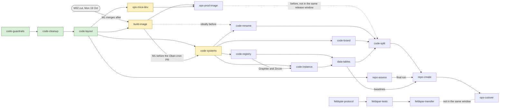

# Nova migration plan: from eyra/mono to Mica + Next

Status: **draft for review**. Each step gets its own issue in the Next Flux project once the plan is approved. The Feldspar track lives in the Feldspar Flux project and in [eyra/feldspar `doc/nova-migration/plan.md`](https://github.com/eyra/feldspar/blob/develop/doc/nova-migration/plan.md).

Related documents:
- [design.md](./design.md): the design, the inventory and the decisions this plan builds on.

Paths in this document are relative to the repository root and refer to the layout *before* code-split, when `core/` still exists. Since code-layout, `core/X` means `core/mica/X`, `core/next/X` or `core/mica_saas/X`; the code-layout section says which.

## How steps are identified

- **Every step has a fixed ID**: a prefix for the kind of work plus a short name, for example `code-systems`. An ID never changes and is never reused. Issues, PRs, commits and code comments refer to steps by ID.
- **Prefixes:**
  - `code-`: the code structure of this repository
  - `build-`: images, CI and the release build
  - `ops-`: infrastructure, deploys and environments
  - `data-`: the database and migrations
  - `repo-`: repositories, history and transfer
  - `feldspar-`: the Feldspar track
- **Order and dependencies live only in this plan**: in the phases, the [dependency diagram](#dependencies) and the "Dependencies" line of each step.
- **Inserting a step** means adding a line to the [steps table](#steps), a node to the diagram and a section in its phase. No other step is renamed.
- Until 2026-10-16 steps had numbers (0–11, 2b, 2c, 9A/9B, F1–F3). The [old numbering](#old-numbering) table maps them to IDs, so older issues and PRs stay traceable.
- One ID was renamed once, before any build work on it: `code-extension` became `code-systems` (2026-10-16). See [old numbering](#old-numbering).

## Steps

| ID | Phase | What | Dependencies | Status |
|---|---|---|---|---|
| [code-guardrails](#code-guardrails--credentials-guardrails-and-communication) | Guardrails | Plan pointers, briefing, credentials | none | done |
| [code-cleanup](#code-cleanup--remove-dead-code-and-retire-banking) | Guardrails | Dead code, retire Banking | none | done |
| [code-layout](#code-layout--early-visible-layout-and-the-boundary-check) | Guardrails | `core/mica`, `core/next`, `core/mica_saas` and the boundary check | code-cleanup | done |
| [ops-mica-dev](#ops-mica-dev--reference-deployment-nova-mica-dev) | Build and reference deployment | Reference deployment `nova-mica-dev` | code-layout; ideally with build-image | next |
| [build-image](#build-image--one-image-and-one-runtimeexs) | Build and reference deployment | One image and one `runtime.exs` (code) | code-layout; M1 after the M32 cut | next |
| [code-systems](#code-systems--coresystem-coresaas-and-open-registries) | Decoupling | `Core.System`, `Core.SaaS` and open registries | code-layout; Oban-cron PR after build-image M1 | next |
| [code-rename](#code-rename--otp-app-rename-core--mica) | Decoupling | OTP app `:core` → `:mica` | code-systems (accessor); ideally build-image | planned |
| [code-brand](#code-brand--brand-and-config-seams) | Decoupling | Brand and config seams | code-systems | planned |
| [code-registry](#code-registry--open-tool-and-item-registry-data-migration) | Decoupling | Tool and item registry | code-systems | planned |
| [code-instance](#code-instance--move-instance-specifics-out-of-mica-fan-out) | Decoupling | PaNL/VU and other instance specifics out of Mica | code-systems; code-registry for Graphite and Zircon | planned |
| [data-tables](#data-tables--table-ownership-migration-paths-and-baselines) | Decoupling | Table ownership, migration paths, baselines | code-registry, code-instance | planned |
| [ops-prod-image](#ops-prod-image--one-image-on-aws-production) | Split and cutover | One image on AWS production | ops-mica-dev, build-image | planned |
| [code-split](#code-split--layout-split-mica-and-next-as-two-mix-projects) | Split and cutover | Separate Mix projects | code-rename, code-brand, code-instance, data-tables | planned |
| [repo-assess](#repo-assess--pre-transfer-assessment) | Split and cutover | Pre-transfer assessment (history, secrets, permissions) | code-layout; final run before repo-create | planned |
| [repo-create](#repo-create--create-the-repositories) | Split and cutover | Create `novasoftwarefoundation/mica` and `eyra/next` | code-split, repo-assess, data-tables | planned |
| [ops-cutover](#ops-cutover--cutover-of-eyra-production-to-eyranext) | Split and cutover | Production cutover to `eyra/next` | repo-create | planned |
| [feldspar-protocol](#track-feldspar-summary) | Feldspar | Mica App Protocol v1 | none | planned |
| [feldspar-tests](#track-feldspar-summary) | Feldspar | Contract tests | feldspar-protocol | planned |
| [feldspar-transfer](#track-feldspar-summary) | Feldspar | Transfer `eyra/feldspar` to Nova | feldspar-tests; own assessment | planned |

## Dependencies

An arrow points from a step to a step that depends on it. Dashed arrows are recommended orders, not prerequisites.

- **Done:** code-guardrails, code-cleanup, code-layout.
- **Next, in parallel:** ops-mica-dev, build-image and code-systems. build-image M1 merges after the M32 cut on Monday 19 October; the code-systems Oban-cron PR merges after build-image M1, because both edit the runtime config.
- **Can start now:** feldspar-protocol, and the first run of repo-assess.
- **Recommended, not blocking:** build-image ideally before code-rename. ops-prod-image (D1, then P after the rehearsal R) before code-split, not in the release window of code-split or ops-cutover.
- **Can run in parallel after code-systems:** code-brand, code-registry and the items of code-instance.
- **Strictly sequential:** code-layout → code-systems, then data-tables → code-split → repo-create → ops-cutover.

## Summary

**The two parts.** `core/` becomes:
- **Mica**: a Mix project with OTP app `:mica`. Modules stay `Core.*`/`CoreWeb.*`. It moves to `novasoftwarefoundation/mica`.
- **Next**: a Phoenix app that depends on Mica through `Core.SaaS` and adds its own systems through `Core.System`. It moves to `eyra/next`.

**How the work is done.** All work happens in this repository on `develop`, in normal small PRs shipped through Next's milestones. There is no long-lived branch and no copy of core.

| Phase | Steps | What happens |
|---|---|---|
| Guardrails | code-guardrails, code-cleanup, code-layout | Record the rules, remove dead code and Banking, make the target layout visible inside `core/`, add a CI boundary check that only lets violations shrink. |
| Build and reference deployment | ops-mica-dev, build-image | Run the neutral reference SaaS on `nova-mica-dev`; build one image per commit from one `runtime.exs`. |
| Decoupling | code-systems, code-rename, code-brand, code-registry, code-instance, data-tables | Open the registries (`Core.System`, `Core.SaaS`), rename the OTP app, add brand and config seams, open the tool/item registry, move PaNL/VU and other instance specifics to Next, give every table one owner and prepare the migration baselines (with a dry run on a production snapshot). |
| Split and cutover | ops-prod-image, code-split, repo-assess, repo-create, ops-cutover | Run the image on AWS production; `git mv` into `mica/` and `next/`; assess what becomes public; create the repositories; cut over Eyra production. |
| Feldspar | feldspar-protocol, feldspar-tests, feldspar-transfer | Versioned Mica App Protocol, contract tests, and the transfer of `eyra/feldspar` to Nova. Planned in the Feldspar repository; summarized here. |

**Production.** Eyra's production Next keeps running at every step. Decoupling steps are invisible to users and are verified by snapshot tests. Three steps carry real operational risk, and each gets a rehearsal on dev/staging and a written rollback:
- code-registry: data migration of tool references
- code-split: new build layout and release pipeline
- ops-cutover: production cutover to `eyra/next`

**Decisions and authorizations still needed:**
- removal of `banking_proxy/` (code-cleanup)
- creating `novasoftwarefoundation/mica` and `eyra/next` (repo-create)
- using a production snapshot and marking the baselines as applied (data-tables and ops-cutover)
- the production cutover (ops-cutover)
- the Feldspar transfer (feldspar-transfer)
- the future of `eyra/mono` after the split

---

## Decisions this plan builds on

Details and rationale are in [design.md](./design.md#decisions).

- **Option A.** `eyra/next` is the root Phoenix project. Mica is a versioned Mix dependency. Every system, in Mica or in a SaaS, implements `Core.System`; the SaaS composes them through `Core.SaaS`. During the migration Next uses `path:` or branch dependencies; afterwards it pins to tags.
- **Governance and graduation.** Mica contains only code under Nova governance. Custom and experimental systems live in the SaaS as `Core.System` systems and can graduate to Mica later: the system moves from the SaaS's list into `Core.mica_systems()`. Graphite and Zircon (with Paper, Annotation, Ontology and Onyx) start in Next, as the proof that the contract works.
- **Optional Mica building blocks:** assignment, fund, affiliate, and pool/advert/promotion.
- **Moves to the SaaS (instance specifics):**
  - PaNL names and panl.nl URLs
  - the `:panl` pool seed
  - `participant?(:panl, …)` checks
  - VU student codes
- **`banking_proxy`** is not deployed anywhere and is retired.
- **OTP app** `:core` is renamed to `:mica` as part of the decoupling. Module names stay.
- **Database:**
  - one database per deployment
  - every table has one owner, with its migrations in the owner's repository
  - foreign keys point only from the SaaS to Mica
  - `workflow_tool_refs` and `project_items` become open registry references
  - at the split, the migrations are squashed into Mica and Next baselines, which are marked as applied in Eyra production after a dry run on a production snapshot
- **Layout.** `core/` is split with `git mv` into `mica/` (Mix project) and `next/` (Phoenix app with `{:mica, path: "../mica"}`). Self is the reference SaaS on Mica: a sibling of Next, not part of Mica (`core/mica_saas/` since code-layout). A separate `novasoftwarefoundation/mica-saas` repository is a later decision.
- **Repositories:**
  - `mica/` goes to `novasoftwarefoundation/mica` with fresh history. Its first commit points back to the `eyra/mono` commit it came from.
  - `next/` goes to `eyra/next`.
  - `eyra/mono` stays available, because Self deployments use it.
- **Deployment model.** One SaaS per deployment. Each operator builds and runs its own SaaS on Mica; multi-tenancy is out of scope.
- **Tracking.** `eyra/mono` work is tracked in Flux project Next; `eyra/feldspar` work in Flux project Feldspar.

## Rules for every step

1. **Small PRs to `develop`.** Each one ships in a regular Next milestone and passes [`test.yml`](../../.github/workflows/test.yml), the smoke tests, and e2e on `eyra-next-dev` and staging. Feature work continues as usual.
2. **The boundary check is a ratchet.** From code-layout on, CI fails on any *new* reference from Mica code to SaaS code (Next or Self), on any reference between the two SaaS, and on new PaNL/VU/Eyra hard-coding in Mica code. The allowlist of existing violations may only shrink.
3. **Behaviour-preserving refactors prove it with snapshots:**
   - the route table (`mix phx.routes`)
   - the GreenLight permission map
   - the signal handler list
   - the Oban cron list
   - rendered emails and layouts for the Next brand
4. **No destructive schema change in the same release as the code that stops using it.** Use the deferred-drop pattern in [`core/docs/schema-deprecations.md`](../../core/docs/schema-deprecations.md).
5. **New code goes in the folder of its future owner** (`core/mica/…` or `core/next/…`) and uses the contract once it exists.

---

## Phase: Guardrails

### code-guardrails — Credentials, guardrails and communication

- **Goal.** Stop credential exposure, make the rules known, and record the decisions.
- **Credentials: done.**
  - The service-login key was rotated on 2026-10-12 on Fly dev/staging and in the GitHub Actions secret. Dev e2e passes and the old key is rejected.
  - Its value is removed from this repository in [#1858](https://github.com/eyra/mono/pull/1858). Production's separate key is removed through eyra/devops PR #98.
  - The Tidewave token is not a secret (Tidewave documents the team token as safe to commit). The dependency is removed in #1858.
  - History is not rewritten: the repository is public and the values were already exposed, so rotation is the fix.
- **Scope.**
  - Add a pointer to this plan in the root [`CLAUDE.md`](../../CLAUDE.md) and in [`core/CLAUDE.md`](../../core/CLAUDE.md), so agents and developers follow the rules.
  - Brief the teams working on Next and Feldspar.
- **Dependencies.** None. Start immediately.
- **Parallel with.** Everything.
- **Eyra prod impact.** None.
- **Verification.** The pointers are in both `CLAUDE.md` files and the teams are briefed.
- **Rollback.** Not applicable.
- **Decisions/authorizations.** None.

### code-cleanup — Remove dead code and retire Banking

- **Goal.** Carry no dead or retired code into either repository.
- **Scope.**
  - Delete dead code:
    - `core/systems/privacy`
    - `core/frameworks/selectical`
    - `core/lib/eyra_core.ex`
    - `core/lib/core/marks.ex`
    - the dead `Next.Desktop` references in [`core/systems/advert/view_model_builders.ex`](../../core/systems/advert/view_model_builders.ex)
    - the dead `Next.Assignment` reference in [`core/frameworks/green_light/loaders.ex`](../../core/frameworks/green_light/loaders.ex)
    - `core/priv/bundles/link` and the bundle `Plug.Static` in [`core/lib/core_web/endpoint.ex`](../../core/lib/core_web/endpoint.ex)
    - the stale `Systems.Questionnaire` grant in [`core/lib/core/authorization.ex`](../../core/lib/core/authorization.ex)
  - Merge the gettext domains with typos: `erya-support`, `eya-zircon`, `eyra.ui`.
  - **Banking:**
    - Remove `core/systems/banking` together with its supervisor in [`core/lib/core/application.ex`](../../core/lib/core/application.ex).
    - Remove `core/lib/banking_client*`.
    - Remove `config :core, BankingClient` and `:banking_backend` from [`core/config/config.exs`](../../core/config/config.exs).
    - Replace the `Banking.Public.is_live?` call in [`core/systems/fund/_public.ex`](../../core/systems/fund/_public.ex).
    - Remove [`banking_proxy/`](../../banking_proxy) and [`.github/workflows/banking_proxy_release.yml`](../../.github/workflows/banking_proxy_release.yml).
    - Put the `money_manager_transaction_marker` table on deferred drop.
- **Dependencies.** None.
- **Parallel with.** code-guardrails, code-layout, track Feldspar.
- **Eyra prod impact.** None expected. Production uses `Systems.Banking.Dummy`, and the removed fetcher only polled the dummy. Ships in a regular milestone.
- **Verification.**
  - The full test suite passes.
  - Fund flows (pay-in, payout) work on staging.
  - Boot logs and `/.status/health` are clean.
- **Rollback.** Revert the PR. The table is dropped only in a later release.
- **Decisions/authorizations.** Deleting `banking_proxy/` from the repository.

### code-layout — Early visible layout and the boundary check

- **Goal.** Make target ownership visible in the tree now and stop new coupling, while the code stays one Mix project.
- **Scope.**
  - **Move folders with `git mv`, inside `core/`.**
    - `core/mica/{lib,systems,frameworks,test}` gets everything Mica will own, including systems that are still entangled.
    - `core/next/{bundle,lib,systems,test}` gets everything Next will own:
      - `core/bundles/next` → `core/next/bundle`
      - the student, citizen, graphite, zircon, paper, annotation, ontology and onyx systems, with `Frameworks.Concept.ScreeningAgent` (moves with Zircon)
      - `core/lib/mix/tasks/e2e.ex`
      - the Next fixtures of `core/frameworks/e2e` (`controller.ex`; `_routes.ex` stays in Mica)
      - the PaNL Wallaby feature tests
    - `core/bundles/self` → `core/mica_saas/bundle`: Self is a sibling SaaS on Mica, not part of Mica (decided 2026-10-14). Bundle id `:self`, `BUNDLE=self` and the `Self.*` modules are unchanged. `SELFHOSTING.md` becomes `core/mica_saas/README.md`; the root keeps a short pointer.
    - Both `bundle/` folders are temporary; code-systems dissolves them into `<saas>/{lib,config}`.
    - `core/test/{e2e,smoke,load,scripts}`, `core/priv`, `core/assets`, `core/config` and the build files stay where they are until code-split.
  - **Follow-up changes:**
    - update `elixirc_paths` in [`core/mix.exs`](../../core/mix.exs) and [`core/.formatter.exs`](../../core/.formatter.exs)
    - update the Tailwind `content` globs in [`core/assets/tailwind.config.js`](../../core/assets/tailwind.config.js)
    - update the `COPY` lines in the [`Dockerfile`](../../Dockerfile) and [`core/Dockerfile`](../../core/Dockerfile)
    - update the bundle import in `config.exs`
  - **Boundary check in CI.** A credo custom check (`core/custom_credo_checks/mica_boundary.ex`) plus a `mix xref` script (`core/scripts/boundary_check.exs`, run in `test.yml`) that:
    - fails when code under `core/mica/**` references a module defined under `core/next/**` or `core/mica_saas/**`, or when `core/next/**` and `core/mica_saas/**` reference each other (xref references and name-only references)
    - fails on new PaNL, VU or Eyra literals under `core/mica/**`: `:panl`, `"Panl"`, `panl.nl`, `eyra.co`, `@eyra.service`, VU study codes
    - uses a committed allowlist of today's violations, `core/boundary_allowlist.exs`: 36 entries in 34 files at the move. It also fails on stale entries, so the list only shrinks.
    - Run it from `core/` after `mix compile`: `elixir scripts/boundary_check.exs`.
- **Dependencies.** Preferably after code-cleanup.
- **Parallel with.** code-guardrails, code-cleanup, track Feldspar.
- **Eyra prod impact.** None at runtime. The risk is breaking the build or deploy. Merge early in a milestone. The PR must build the Fly image, the AWS release tarball and both Docker images.
- **Verification.**
  - The release contains the same set of `.beam` modules as before.
  - The snapshots are green.
  - The boundary check reports the allowlist count.
- **Rollback.** Revert the move PR. Other open PRs need a rebase, so agree the merge moment with the Next team.
- **Decisions/authorizations.** A short merge freeze around the move PR.

> Why move folders now but create separate Mix projects only in code-split: a separate Mica project cannot compile while Mica code still references Next modules. Moving folders inside one project makes the boundary visible and enforceable from day one. code-split is then a second `git mv` plus two `mix.exs` files. `git log --follow` and blame survive both renames.

---

## Phase: Build and reference deployment

### ops-mica-dev — Reference deployment `nova-mica-dev`

- **Goal.** Keep the self-hosted variant verified at all times, and prove Mica's neutrality with a second live SaaS next to Next.
- **Scope.** Tracked in the Flux issue [Reference deployment nova-mica-dev on Fly](https://app.basecamp.com/5734045/buckets/35926565/todos/10408245047).
  - A permanent Fly app `nova-mica-dev` that runs the neutral reference SaaS `mica_saas`. The server name has no "saas", because every running service is a SaaS deployment; the code and the repository keep `mica_saas` and `mica-saas`.
  - A Fly Postgres database and a storage bucket. Machines stop when idle.
  - Auto-deploy from `develop`, like `eyra-next-dev`.
  - A smoke test after each deploy: the start page, sign-in and `/.status/health`.
  - Neutral configuration: no Eyra branding and no Eyra secrets. The configuration is documented in `core/mica_saas/README.md`.
- **Dependencies.** After code-layout. Ideally together with build-image: the app then deploys the private `ghcr.io/eyra/self` image by digest. Until then, it builds from `core/Dockerfile` with `BUNDLE=self`.
- **Parallel with.** build-image, code-systems and later steps, track Feldspar. It doubles as the rehearsal environment for build-image (R).
- **Eyra prod impact.** None. It is a separate Fly app with its own database, bucket and secrets.
- **Risks.** `BUNDLE=self` compiles with 17 `no route path` warnings, so the first deploy may show broken Self pages. The fixes belong to code-systems and code-brand, not to this step; the smoke test covers only the pages listed above.
- **Verification.**
  - A push to `develop` deploys to `nova-mica-dev`, and the smoke test passes.
  - The deployed app shows no Eyra branding and uses no Eyra secrets.
  - Machines stop when idle and start again on the next request.
- **Rollback.** Stop or delete the Fly app; nothing else depends on it.
- **Decisions/authorizations.** Creating the Fly app, its database and bucket, and their monthly cost.

### build-image — One image and one `runtime.exs`

- **Goal.** Build one image per commit and run that same image on Fly dev and Fly staging, and with ops-prod-image on AWS production, so staging tests exactly what production runs. Recommended, not blocking for the code steps: with build-image, code-rename and code-split handle one runtime file, one Dockerfile and one build workflow; without it, they work as written.
- **Scope.** The code in this repository (PRs M1–M4 and the rehearsal R); the devops and production part is ops-prod-image. Tracked in the Flux issue [One image for prod and Fly](https://app.basecamp.com/5734045/buckets/35926565/todos/10403641634).
  - One Dockerfile and one platform-neutral `runtime.exs`. One image per commit. Fly deploys it by digest. AWS production runs the same image as a container on the existing EC2 nodes (ops-prod-image). Until then, the release tarball is extracted from the image.
  - **M1.** One platform-neutral `core/config/runtime.exs` replaces `runtime.aws.exs`, `runtime.fly.exs`, `runtime.dev.exs` and the copy steps. Environment variables choose the setup, not the platform. An equivalence test compares the old and new config with the production and Fly environments.
    - **Variable names (decided: one name per setting, no aliases).** Every setting has one environment variable name in all environments from the start:
      - `DATABASE_URL`: the database
      - `AWS_S3_BUCKET`: the private bucket
      - `PUBLIC_S3_BUCKET`: the public bucket
      - `APPSIGNAL_REVISION`: the release revision, set inside the image at build time

      The order:
      1. Add the new names everywhere first. A devops PR adds `DATABASE_URL` on AWS next to `DB_URL`; Fly gets `AWS_S3_BUCKET` and `PUBLIC_S3_BUCKET` as staged secrets.
      2. M1 reads only these names, with `System.fetch_env!` for the required ones.
      3. Then the old names are removed: `DB_URL`, `DB_USER`/`DB_PASS`/`DB_HOST`/`DB_NAME`, and the reliance on `BUCKET_NAME`.

      Database TLS SNI then comes from the URL host instead of `DB_HOST`; M1 tests this on staging first.
    - **Required risk measures.** One file means a change made for Fly can reach production. M1 ships with all six measures:
      1. **Config snapshot tests in CI (primary safeguard).** CI loads `runtime.exs` with fixed environment-variable fixtures per environment (prod/AWS, staging, dev) and compares the resulting config to committed snapshots. Any change to the prod snapshot fails CI until the snapshot diff is reviewed and updated. This restores what separate runtime files gave: a Fly change cannot silently reach production.
      2. **Pre-restart check.** `predeploy` validates the config against the real production environment (required variables present, values valid) before the restart. On failure the deploy stops and the old version keeps running. Required settings use `System.fetch_env!`.
      3. **No platform branches and no aliases.** AWS/Fly differences are only environment values, and every setting is read under one name (see above).
      4. **Staging runs what production runs.** Staging runs the same image and `runtime.exs` as production. A parity script compares which environment variable *names* are set on production and on staging.
      5. **Gradual rollout.** Canary on node 02, then node 01 (P in ops-prod-image). On a failed health check, roll back to the previous image digest.
      6. **CODEOWNERS rule.** Changes to `runtime.exs` need approval from a code owner (for example Joeri).
  - **M2.** `FORCE_SSL` becomes a runtime plug, the unused `SSL_PROXIED` goes, and the release refuses to boot clustered without `RELEASE_COOKIE`.
  - **M3.** One `core/Dockerfile`, built with the repository root as context, on the versions in `.tool-versions`. The root `Dockerfile` is deleted.
  - **M4.** A build workflow pushes one image per commit to GHCR. Fly dev and staging deploy it by digest. `release.yml` tags the image staging tested and extracts the release tarball from it, so the AWS deploy flow does not change yet.
  - **R. Rehearsal on Fly.** There is no AWS test machine anymore. The rehearsal runs on [`nova-mica-dev`](#ops-mica-dev--reference-deployment-nova-mica-dev) (ops-mica-dev), whose Self image shares the Dockerfile, `runtime.exs`, Mica helpers, release scripts and build workflow with the Next image; a temporary Fly app is the fallback if ops-mica-dev is not there yet. It uses the same variable names as production (`DATABASE_URL`, `AWS_S3_BUCKET`, `PUBLIC_S3_BUCKET`). For one window its secrets switch to the production setup, then back: SES selected instead of Mailgun, the Yoda storage default. It covers two machines, rolling deploys by digest and a rollback to the previous digest. A container smoke job in CI (M4) also runs every image the way production will: non-root user, bind mounts, database TLS, two clustered containers.
- **Constraints.** These also apply to ops-prod-image.
  - One runtime config file serves Fly and AWS alike (Joeri). The platform behaves the same wherever it is deployed; only environment variable values differ. What differs by design is how each platform deploys: how migrations are triggered, where secrets live, volumes, and the proxy in front. One of those affects behaviour: nginx's upload limit (`client_max_body_size` 210 MB) and its rate limit exist only on AWS, not on Fly. Keep that in mind when testing uploads on Fly.
  - The registry is GHCR. The images `ghcr.io/eyra/next` and `ghcr.io/eyra/self` are **private**, because they are part of Eyra's devops. Production pulls with a read-only token from the vault. Fly deploys a byte-for-byte copy in its own registry (`registry.fly.io`), so the digest stays the same.
  - The release name `bin/core` does not change. Environment variable names change only where one setting had two names (see M1).
  - `runtime.exs` is written as Next's config on generic helpers, so it can move to `next/` in code-split without carrying Eyra literals into Mica.
  - `BUNDLE` stays a build argument until code-split: one image per bundle.
- **Dependencies.** code-layout (the merge freeze is over). M1 merges after the M32 cut on Monday 19 October. M1 lands before the code-systems Oban-cron PR, and ideally before code-rename, because both edit the runtime config.
- **Parallel with.** ops-mica-dev, code-systems and later steps, track Feldspar.
- **Eyra prod impact.** Production runs the release extracted from the image staging tested, through the normal AWS flow.
- **Verification.**
  - The equivalence test shows only the intended config differences.
  - The six M1 risk measures are in place: config snapshots in CI, one name per setting with no aliases, the pre-restart check in `predeploy`, the env-name parity script, the rollback to the previous digest, and the CODEOWNERS rule for `runtime.exs`.
  - Fly dev and staging deploy by digest, and e2e passes.
  - A milestone ships to production as the extracted tarball without new errors in AppSignal.
  - In the rehearsal (R): clustering, the node-local Oban queue, upload and donation file owners, database TLS, mail, S3, login and the AppSignal revision.
- **Rollback.** Revert the PR.
- **Decisions/authorizations.** None. The rehearsal (R) is a precondition for ops-prod-image.

---

## Phase: Decoupling (still one Mix project)

code-systems and code-brand fix the contract, and code-registry, code-instance and data-tables build on it. Once code-systems is merged, code-instance fans out into parallel PRs, one per item. Every step lowers the allowlist count.

### code-systems — `Core.System`, `Core.SaaS` and open registries

- **Goal.** A SaaS, and each Mica system, can add routes, grants, handlers and so on without editing a central list.
- **Scope.**
  - **The `Core.System` behaviour,** one per system: `Systems.X.System` in the system's `_system.ex`. It covers:
    - routes, grants, signal handlers, notifiers and notify channels
    - supervisor children, Oban queues and crons, rate quotas
    - seeds and the migrations path
    - feature flags (declared, default off)
    - admin panels and account features

    A system can use the extension points of other systems, so a SaaS extends Mica's systems through its own systems.
  - **The `Core.SaaS` behaviour,** one per SaaS: `Next.SaaS` and `Self.SaaS`. `systems/0` returns Mica's systems (`Core.mica_systems()`) plus the SaaS's own. It also holds the SaaS-level config: start pages, menus, feature-flag defaults and, later, the brand (code-brand). The SaaS is selected with `config :core, saas: Next.SaaS`.

    See [design.md §3.3](./design.md#33-the-coresystem-and-coresaas-contracts).
  - **Convert.** Each Mica system gets a `Systems.X.System`; the Next and Self bundles become `Next.SaaS` and `Self.SaaS`, and the systems that live in Next get their own `Core.System` modules.
  - **Replace the hand-maintained lists:**
    - [`core/systems/routes.ex`](../../core/systems/routes.ex)
    - the static grants in [`core/lib/core/authorization.ex`](../../core/lib/core/authorization.ex)
    - the `:signal` handler list and the `Systems.Notify` notifier list in [`core/config/config.exs`](../../core/config/config.exs)
    - [`core/lib/core/bundle_overrides.ex`](../../core/lib/core/bundle_overrides.ex)
    - the `core/.bundle.ex` selection; instead, config names the SaaS module
  - **Oban crons.** Move them into the `Core.System` declarations, keeping the environment toggles from `runtime.*.exs`.
  - **Feature flags.**
    - Declared flags default to *off*. [`core/lib/core/feature_flags.ex`](../../core/lib/core/feature_flags.ex) treats an unconfigured flag as on today.
    - Next declares its current defaults, so the flags in effect stay identical.
    - Check production's `ENABLED_APP_FEATURES` first.
  - **Prepare the OTP rename.** Add one accessor (for example `Core.Env.get/2`) and route the roughly 66 `Application.*env(:core, …)` calls through it.
- **Dependencies.** code-layout. The Oban-cron PR merges after build-image M1.
- **Parallel with.** build-image, ops-mica-dev, code-brand, track Feldspar. The conversion can be split into several PRs after the behaviour PR.
- **Eyra prod impact.** None intended. Ships over one or two milestones.
- **Verification.**
  - The route, permission, handler and cron snapshots are identical.
  - `/.status/features` is identical on staging and production before and after.
- **Rollback.** Revert. No data changes.
- **Decisions/authorizations.** None.

### code-rename — OTP app rename `:core` → `:mica`

- **Goal.** Do the decided rename while there is still one project, as a small PR.
- **Scope.**
  - Set `app: :mica` in `core/mix.exs`.
  - Rename `config :core, …` to `config :mica, …` in all config files.
  - Update the accessor.
  - Update the call sites that name the app: `otp_app: :core`, `app_dir(:core, …)`, `from: :core` (about 10).
  - Update the Gettext backend and the `priv` paths.
  - Keep the release binary name `core` for now (`releases: [core: …]`). [`core/scripts/predeploy`](../../core/scripts/predeploy), [`core/scripts/docker-start-app`](../../core/scripts/docker-start-app), the root `Dockerfile` entrypoint and Eyra's AWS deploy tooling (outside this repository) all call `bin/core`.
- **Dependencies.** The accessor from code-systems. Ideally after build-image.
- **Parallel with.** code-brand, code-registry, code-instance.
- **Eyra prod impact.** Build-level only. Environment variable names do not change. Rehearse the release build and deploy on `eyra-next-dev` and staging, and run one AWS release build. If build-image has landed, there is one runtime file to rename, and the AWS tarball comes from the image staging ran.
- **Verification.**
  - The app boots on dev and staging.
  - Smoke tests pass.
  - `predeploy` runs migrations and seeds.
- **Rollback.** Revert the PR.
- **Decisions/authorizations.** Whether the release binary stays `core` or becomes `next` (open question 3).

### code-brand — Brand and config seams

- **Goal.** Mica code contains no Eyra or Next branding and no instance config, and Next reproduces today's output exactly.
- **Scope.**
  - **`Core.Brand` behaviour with a neutral Mica default.** `Next.Brand` provides:
    - name and logos
    - footer, now in [`core/frameworks/pixel/components/footer.ex`](../../core/frameworks/pixel/components/footer.ex) (the "Powered by Eyra" line becomes Next's choice)
    - policy URLs (`next_*` and `panl_*` in `core/config/config.exs`)
    - support email
    - email signature and "Next" wording in `core/systems/email/email/*.eex`
    - mail-from address
    - AppSignal name
    - invoice prefix and merchant/donation recipient name, from `core/systems/fund/_public.ex`
    - manifest and favicons
  - **Instance config moves to Next's config:** partner/pool logos (`:pixel, :pool_assets`), auth method lists, post-sign-in pages.
  - **Translations.**
    - Rename the `eyra-*` gettext domains to neutral names in one scripted PR.
    - Replace brand words in msgstrs with brand interpolation.
    - Give Next its own Gettext backend for the `eyra-next` and PaNL copy.
  - **De-brand Pixel:** the footer, the logo catalogue and the `__eyra_field_*` attributes.
- **Dependencies.** code-systems.
- **Parallel with.** code-registry and code-instance, track Feldspar. Schedule the gettext rename at a quiet moment, because it touches every `dgettext` call.
- **Eyra prod impact.** None visible.
- **Verification.**
  - Snapshot tests of every email template and of the app, workspace and website layouts for Next.
  - All 7 locales resolve.
  - On staging, manually check the sign-up email, the OTP email, the footer and the terms page.
- **Rollback.** Revert.
- **Decisions/authorizations.** Whether Mica shows "Powered by Mica / Nova" by default (open question 7).

### code-registry — Open tool and item registry (data migration)

- **Goal.** Next, and later anyone, can add tools and project items without a Mica migration. This is required before Graphite and Zircon can live in Next.
- **Scope.**
  - **`Core.Tool` behaviour:** type, schema, prepare, form/view, director, export/import, icon/title.
  - **Registry references.**
    - Add `tool_type`/`tool_id` to `workflow_tool_refs` and `item_type`/`item_id` to `project_items`.
    - Backfill them from the per-tool foreign-key columns, which are defined today in [`core/systems/workflow/tool_ref_model.ex`](../../core/systems/workflow/tool_ref_model.ex) and [`core/systems/project/item_model.ex`](../../core/systems/project/item_model.ex).
    - Switch reads to the new columns, and put the old ones on deferred drop.
  - **Directors** become registry-validated strings instead of compile-time `Ecto.Enum` values.
  - **Assignment and Workflow** lose their hard-wired Zircon/Lab/Feldspar handling.
  - **`Workflow.Platforms`** moves to the Feldspar side.
- **Dependencies.** code-systems.
- **Parallel with.** code-brand, the parts of code-instance that don't touch tools, track Feldspar.
- **Eyra prod impact.** **A data migration on live tables**, in three releases:
  1. Add the columns, backfill and dual-write.
  2. Switch reads.
  3. Drop the old columns, at least one milestone later.

  Rehearse each release on a copy of production data and on staging.
- **Verification.**
  - Backfill counts match.
  - The integrity handling on tool delete is tested.
  - e2e passes for creating, running and exporting assignments with each tool type.
  - The setup export/import round-trip works.
- **Rollback.** For releases 1 and 2, revert the code; the old columns are still in sync. Release 3 happens only after a full milestone without issues.
- **Decisions/authorizations.** The user approves the data migration plan before release 1.

### code-instance — Move instance specifics out of Mica (fan-out)

- **Goal.** Remove the remaining boundary violations, so Mica code uses only the contract.
- **Scope.** One PR series per item. Each moves code to `core/next/**` behind an extension point and lowers the allowlist.
  - **PaNL:**
    - the sign-up privacy flow and the `add_to_panl` post-action
    - `participant?(:panl)` checks in account features
    - the finished-view "Join Panl" call to action
    - the paid-slot PaNL policy and the questionnaire runtime config
    - the home marketplace block
    - project item gating and advert marks
    - `get_or_create_panl` and the `:panl` pool seed in [`core/lib/core/seeds/base.ex`](../../core/lib/core/seeds/base.ex)
    - the PaNL e2e fixtures
  - **VU:**
    - student codes and `generate_vu`
    - `VUDaySchedule`, which becomes Lab config supplied by Next
    - the student promotion next action
  - **Pool directors.** Citizen and Student register as pool directors from Next.
  - **Admin and Org.** The citizen/pool admin settings and the Org pools tab become panels contributed by Next systems through Mica's extension points.
  - **Home.** Mica gets a minimal default home. Next's current home moves to Next and is set through start pages.
  - **Eyra-domain synthetic accounts.** The `@eyra.service`, `external+…@eyra.co` and `@next.eyra.co` addresses become config with Next's values.
  - **External panel ids.** `liss` and `ioresearch` become Next config. Mica keeps `generic`.
  - **Integrations.** SURFconext and Centerdata auth, the OPP payment provider and Yoda storage move behind their behaviours. They go to `core/next/integrations` until their owner is decided (open question 5). Only Nova-governed code goes into Mica; they can graduate later.
  - **Graphite and Zircon** (with Paper, Annotation, Ontology, Onyx):
    - depend only on `Core.Tool` and `Core.System`
    - the screening agent concept moves with Zircon
    - the Paper registry moves from `Core.Application` into Zircon's system children
  - **Remaining dependency cycles** are broken with signals or behaviours where the direction would otherwise be Mica → Next:
    - Account ↔ Fund/Payment
    - Assignment ↔ Pool/Advert
    - Fund ↔ Advert/Pool
- **Dependencies.** code-systems. Graphite and Zircon also need code-registry.
- **Parallel with.** Most items run in parallel, each with its own Flux issue and worktree. Coordinate with ongoing Next feature work in the same systems.
- **Eyra prod impact.** None visible per PR. Ships continuously over several milestones.
- **Verification.**
  - The allowlist shrinks with every PR, and the snapshots are unchanged.
  - The PaNL journeys stay green in e2e: sign-up with PaNL consent, finished-view call to action, marketplace.
  - The student and citizen pool flows work on staging.
- **Rollback.** Revert per PR.
- **Decisions/authorizations.** Ownership of the integrations (open question 5).
- **Done when:**
  - the allowlist is empty
  - `core/mica/**` compiles without `core/next/**` (a CI job does exactly this)

### data-tables — Table ownership, migration paths and baselines

- **Goal.** Every table has one owner, migrations live with that owner, and foreign keys point only from the SaaS to Mica. The squashed Mica and Next baselines are ready and rehearsed for repo-create and ops-cutover.
- **Scope.**
  - **Ownership manifest:** each table mapped to its owner, generated from the Ecto schemas in each folder and checked in CI.
  - **CI check:** no foreign key from a Mica table to a Next table. Fix any violations found; code-registry resolves most of them.
  - **Split the migrations.** Divide `core/priv/repo/migrations` into a Mica path and a Next path by owner. Filenames and versions stay unchanged.
  - **Run both paths.** `Core.Release.migrate/0` and `mix ecto.migrate` run the Mica path plus the migration paths the SaaS and its systems declare.
  - **Mixed migrations.** Historical migrations that touch both owners stay in Mica's path until the baseline squash below.
  - **Seeds** are declared per system.
  - **Baselines,** after the migration split:
    - Generate a Mica baseline and a Next baseline migration.
    - Write the script that inserts their versions into `schema_migrations`.
    - Dry run on a restored production snapshot in an isolated environment:
      - nothing is pending
      - the schema dump is unchanged
      - a fresh database built from the baselines matches production's schema
    - Also test the rollback script, which deletes the inserted rows.
- **Dependencies.** code-registry and code-instance.
- **Parallel with.** Rest of code-brand, track Feldspar, repo-assess. The baselines run in parallel with code-split.
- **Eyra prod impact.** None. These are the same migration versions, already applied. The production snapshot contains personal data, so handle it with the same controls as backups.
- **Verification.**
  - A fresh database built from both paths matches today's [`core/priv/repo/structure.sql`](../../core/priv/repo/structure.sql).
  - On a production snapshot, nothing is pending.
  - The baseline dry-run evidence (schema diffs, pending-migrations output) goes on the Flux issue.
- **Rollback.** Revert the file moves.
- **Decisions/authorizations.** Using a production snapshot.

---

## Phase: Split and cutover

### ops-prod-image — One image on AWS production

- **Goal.** AWS production runs the same image as Fly dev and staging, as a container on the existing EC2 nodes, instead of the release tarball.
- **Scope.** D1 and P; D1 in `eyra/devops`. Tracked in the Flux issue [One image for prod and Fly](https://app.basecamp.com/5734045/buckets/35926565/todos/10403641634). The only production environment change is the one-name-per-setting order under build-image M1: `DATABASE_URL` is added next to `DB_URL` before M1, and the old names are removed after it. The constraints of build-image apply.
  - **D1. Container runtime in `eyra/devops`.**
    - An Ansible `docker` role installs Docker CE on the existing EC2 nodes.
    - A systemd unit, still called `next.service`, runs the image by digest with host networking, the host's `next` user and an env file that Ansible renders from the same vault variables as today's unit. Before switching, it checks that the variable names match the running unit. Logs still reach Grafana as `next.service`.
    - An nginx drain location takes one node out of the load balancer before it restarts.
    - The playbook pulls on both nodes, migrates once, then restarts one node at a time.
    - A per-host switch, `next_runtime`, chooses between the tarball unit (default) and the container unit.
  - **P. Production switch,** each part with its own go-ahead and rollback:
    1. **Preparation**, restarting nothing: install Docker, write the env file, pull the current image, add the drain location, then test the drain alone on node 02.
    2. **Canary on node 02**, with the release that already runs as a tarball. Drain node 02, start the container unit, check health, clustering with node 01, database TLS, mail and S3 config, the node-local Oban queue, logs and file owners while it is still drained, then undrain. Node 01 keeps the tarball of the same commit. Soak for one milestone.
    3. **Node 01** switches the same way. From then on, migrations run through the container. The tarball is retired two milestones later.
- **Dependencies.** build-image (the images from M4 and the rehearsal R) and ops-mica-dev (hosts R). Recommended, not blocking: lands any time before code-split.
- **Parallel with.** The decoupling steps, track Feldspar. Not in the same release window as code-split or ops-cutover: one change to the production pipeline at a time.
- **Eyra prod impact.** P is an operational cutover from the tarball to the container, one production node at a time.
- **Verification.** In each step of P: clustering, the node-local Oban queue, upload and donation file owners, database TLS, mail, S3, login and the AppSignal revision.
- **Rollback.** Per host: drain, set `next_runtime` back to the tarball, start the tarball unit of the same release (still on disk) and undrain. The tarball stays available for two milestones after node 01 switches.
- **Decisions/authorizations.** **Each part of the AWS production switch (P: preparation, canary on node 02, node 01) needs the rehearsal (R), a rollback to the tarball, and the user's go-ahead.**

### code-split — Layout split: `mica/` and `next/` as two Mix projects

- **Goal.** Two real Mix projects in this repository, with `core/` gone. This is the shape the repositories will have.
- **Scope.**
  - **`git mv core/mica mica/`.** This is the Mix project `:mica`, with its own `mix.exs`, `priv`, gettext and neutral static assets. Where Self (`core/mica_saas/`) goes in code-split is open question 2.
  - **`git mv core/next next/`.** This is the Phoenix app `:next`, with `{:mica, path: "../mica"}`. Next owns:
    - endpoint and router composition
    - config, including `runtime.fly.exs` and `runtime.aws.exs`
    - `rel/`, the Dockerfile, `fly.*.toml` and the scripts
    - `assets/`, which imports Mica's JS hooks and adds Mica to the Tailwind content
    - the e2e, smoke and load tests
  - **Mica keeps its own tests.** They run against the reference SaaS.
  - **Workflows.**
    - Update `release.yml`, `docker_release.yml`, `fly-deploy-*.yml` and `e2e*.yml` to build from `next/`.
    - Add a Mica CI job that builds and tests `mica/` on its own.
    - The `BUNDLE` build argument disappears.
    - If build-image has landed, this moves one `runtime.exs`, one Dockerfile and one build workflow instead.
  - **Self.** Self deployments keep building from a pinned tag of this repository from before code-split, unless the reference SaaS is made deployable for them first (open question 2).
- **Dependencies.** code-systems, code-rename, code-brand, code-registry, code-instance and data-tables: the allowlist is empty and the standalone compile job is green.
- **Parallel with.** repo-assess, the data-tables baselines, track Feldspar.
- **Eyra prod impact.** The build and release pipeline changes; runtime behaviour must not. Rollout:
  1. Rehearse on a branch. Build the Fly image and the AWS tarball from `next/`, deploy to `eyra-next-dev`, and run e2e and smoke tests. If build-image has landed, build the one image instead.
  2. Merge at the start of a milestone.
  3. Run the full e2e on staging.
  4. Ship to production through the normal AWS release flow. The binary name is unchanged.
- **Verification.**
  - The release diff shows the same modules (now across `:mica` and `:next`), the same migration versions and the same route and permission snapshots.
  - Smoke tests pass on production after the release.
- **Rollback.** Redeploy the previous release artifact. Reverting the move itself is possible but heavy.
- **Decisions/authorizations.** The merge moment, agreed with the Next team. The user decides the Self strategy.

### repo-assess — Pre-transfer assessment

- **Goal.** Know exactly what becomes public or accessible under `novasoftwarefoundation`. The database baselines are part of data-tables.
- **Scope.** A read-only report covering:
  - **Content of `mica/`:**
    - a secrets scan of the tree (for example gitleaks)
    - Eyra-private material: customer names, internal hosts, fixtures with real e-mail domains
    - docs and agent instructions that describe Eyra infrastructure
  - **History.** Mica starts with fresh history, so only the tree is published. Confirm that pointing the first commit back to `eyra/mono`, which stays public, is acceptable.
  - **Licence.** This repository and `eyra/feldspar` are AGPL-3.0 ([`COPYING.md`](../../COPYING.md)). Two questions need legal input, not an engineering answer:
    - the copyright holder and notices under Nova, and a contributor agreement for non-Eyra contributors
    - the consequences for operators, including for `eyra/next`
  - **Dependencies.** Mica would rely on these Eyra-owned forks: `bamboo_phoenix`, `bamboo_ses`, `live_nest`, `packmatic`. `@novasoftwarefoundation/prism` already belongs to Nova.
  - **GitHub setup:**
    - org access, teams and branch protection
    - Actions secrets for Mica CI (no Eyra production secrets)
    - Renovate
    - the docs site ([`docs.yml`](../../.github/workflows/docs.yml))
    - the [`SECURITY.md`](../../SECURITY.md) contact
- **Dependencies.** Can start after code-layout and is re-run on the final tree before repo-create.
- **Parallel with.** code-split, data-tables, track Feldspar.
- **Eyra prod impact.** None.
- **Verification.** The user reviews the report.
- **Rollback.** Not applicable.
- **Decisions/authorizations.** Accepting the assessment, including the licence answer, before repo-create.

### repo-create — Create the repositories

- **Goal.** `novasoftwarefoundation/mica` and `eyra/next` exist and build. `eyra/mono` remains the source of truth until ops-cutover.
- **Scope.**
  - **`novasoftwarefoundation/mica`:**
    - fresh history; the first commit is `mica/` at `eyra/mono` commit X, with a message pointing to `eyra/mono@X`
    - the Mica baseline, CI and branch protection
    - tag `v0.1.0`
  - **`eyra/next`:**
    - built from `next/` plus the root files Eyra needs
    - history approach is open question 4
    - `{:mica, github: "novasoftwarefoundation/mica", tag: "v0.1.0"}`
    - the Next baseline, workflows and Fly config; secrets are re-created in the new repository
  - **Sync window.** Changes on `eyra/mono` after X are replayed, or development pauses briefly. Keep the window to days.
- **Dependencies.** code-split, repo-assess and the data-tables baselines.
- **Parallel with.** Track Feldspar.
- **Eyra prod impact.** None yet. `eyra/next` deploys only to `eyra-next-dev`.
- **Verification.**
  - Mica CI is green on its own.
  - `eyra/next` builds the same release as `eyra/mono@X`.
  - Full e2e passes on dev.
- **Rollback.** Archive the new repositories. Nothing depends on them yet.
- **Decisions/authorizations.**
  - **The user authorizes creating `novasoftwarefoundation/mica` (public) and `eyra/next`.**
  - The user decides who gets admin rights on the Nova repository.

### ops-cutover — Cutover of Eyra production to `eyra/next`

- **Goal.** Eyra's production Next is built and released from `eyra/next`, with Mica as a tagged dependency.
- **Migration plan.**
  1. Freeze Next development on `eyra/mono`, do the final sync, and tag it `pre-split-final`.
  2. Deploy `eyra/next` to staging and run the full e2e.
  3. In a maintenance window on production:
     - take a backup
     - run the baseline-marking script (rehearsed in data-tables)
     - deploy the `eyra/next` release through the normal AWS flow
     - run `predeploy`; nothing should be pending
     - run the smoke tests
  4. Point the Fly dev/staging workflows and the AWS release source at `eyra/next`, and disable the Next workflows in `eyra/mono`.
  5. Monitor AppSignal and the job queues for one milestone.
- **Rollback plan.**
  - Before the baseline marking: abort and keep `eyra/mono`.
  - After the marking: the marking only *adds* `schema_migrations` rows, so the previous `eyra/mono` release still runs. Redeploy it, and if needed remove the inserted rows with the tested script.
  - The cutover release contains no destructive schema change.
- **Dependencies.** repo-create is verified.
- **Parallel with.** Track Feldspar, but not feldspar-transfer in the same window.
- **Eyra prod impact.** One planned release with a short maintenance window.
- **Verification.**
  - Smoke and e2e pass on production, and nothing is pending.
  - AppSignal error rates are unchanged for 48 hours.
  - Data donation delivery, payment webhooks and reconciliation all work.
- **Decisions/authorizations.**
  - **The user authorizes the cutover and the maintenance window.**
  - The user decides the status of `eyra/mono` afterwards (open question 1).

---

## Track: Feldspar (summary)

Full plan: [eyra/feldspar `doc/nova-migration/plan.md`](https://github.com/eyra/feldspar/blob/develop/doc/nova-migration/plan.md). Tracked in the Feldspar Flux project.

- **feldspar-protocol — Mica App Protocol v1.**
  - Write down the current postMessage/MessagePort and HTTP protocol as a versioned spec in Mica's docs.
  - Add a backward-compatible version handshake.
  - Tighten the origin checks on both sides.
  - The host side lives in [`core/assets/js/feldspar_app.js`](../../core/assets/js/feldspar_app.js) and [`core/systems/feldspar`](../../core/systems/feldspar).
  - Can start now.
- **feldspar-tests — Contract tests.** Shared fixtures run in both CIs. Depends on feldspar-protocol.
- **feldspar-transfer — Transfer `eyra/feldspar` to `novasoftwarefoundation/feldspar`.**
  - It is a GitHub transfer, so the full history moves. It needs its own pre-transfer assessment and the user's authorization.
  - After the transfer, update the Feldspar release URL in `core/frameworks/e2e/controller.ex`.
  - Not in the same window as ops-cutover.

## Old numbering

Until 2026-10-16 steps had numbers. Issues, PRs and commits from before then use them.

| Old number | ID |
|---|---|
| Step 0 | code-guardrails |
| Step 1 | code-cleanup |
| Step 2 | code-layout |
| Step 2b (whole step) | build-image and ops-prod-image |
| Step 2b-1 (M1–M4, R) | build-image |
| Step 2b-2 (D1, P) | ops-prod-image |
| Step 2c | ops-mica-dev |
| Step 3 | code-systems |
| Step 3b | code-rename |
| Step 4 | code-brand |
| Step 5 | code-registry |
| Step 6 | code-instance |
| Step 7 | data-tables |
| Step 8 | code-split |
| Step 9, part A (9A) | repo-assess |
| Step 9, part B (9B, baselines) | data-tables |
| Step 10 | repo-create |
| Step 11 | ops-cutover |
| F1 | feldspar-protocol |
| F2 | feldspar-tests |
| F3 | feldspar-transfer |

One step ID was renamed, on 2026-10-16, before any build work on that step had started. It is the only rename; IDs do not change once work refers to them.

| Old ID | ID |
|---|---|
| code-extension | code-systems |

## Open questions

1. **`eyra/mono` after the split.** Read-only/archived, or security fixes for the Self deployments that use it? If fixes: who backports them, and for how long? Should Self move to Mica's reference SaaS (or `novasoftwarefoundation/mica-saas`) instead, and when?
2. **Self during code-split.** Do Self deployments pin to a pre-split tag, or must the reference SaaS be deployable for them first?
3. **Release binary name.** Keep `bin/core` through the cutover, or rename to `next`? Renaming requires changing Eyra's AWS deploy tooling.
4. **`eyra/next` history.** Fresh start with a pointer (like Mica), or filtered full history?
5. **Integrations** (OPP, Yoda, SURFconext, Centerdata). Mica building blocks under Nova governance, separate Nova-owned packages, or Next?
6. **Generic cloud backends** (S3/Tigris, Azure storage, Mailgun/SES). Mica core or integration packages?
7. **"Powered by Mica / Nova".** A default in Mica's brand, configurable, or nothing?
8. **Eyra-owned forks** used as Mica dependencies (`bamboo_phoenix`, `bamboo_ses`, `live_nest`, `packmatic`). Move them to Nova, upstream them, or keep them as Eyra-maintained?
9. **Licence and copyright.** Copyright holder for Mica and Feldspar after the move, and the AGPL-3.0 consequences for operators. This needs legal input.
10. **Translation overrides.** Do SaaS repositories need to override Mica's UI copy?

Written by an AI agent (Claude Code · Claude Opus 5.5, herdr-projects nova-migration · t-0001; step IDs by t-0016).
