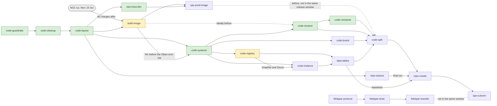

# Nova migration plan: from eyra/mono to Mica + Next

Status: **draft for review**. Each step gets its own issue in the Next Flux project once the plan is approved. The Feldspar track lives in the Feldspar Flux project and in [eyra/feldspar `doc/nova-migration/plan.md`](https://github.com/eyra/feldspar/blob/develop/doc/nova-migration/plan.md).

Related documents:
- [design.md](./design.md): the design, the inventory and the decisions this plan builds on.

Paths in this document are relative to the repository root and refer to the layout *before* code-split, when `core/` still exists. Since code-layout, `core/X` means `core/mica/X`, `core/next/X` or `core/mica_saas/X`; the code-layout section says which. Module names (`Core.System`, `CoreWeb.Router`, …) are the names before [code-rename](#code-rename--rename-the-otp-app-and-the-namespaces-to-mica); from then on they are `Mica.*` and `MicaWeb.*`. code-compose comes after code-rename, so its section uses the Mica names.

## How steps are identified

- **Every step has a fixed ID**: a prefix for the kind of work plus a short name, for example `code-systems`. An ID never changes and is never reused. Issues, PRs, commits and code comments refer to steps by ID.
- **Prefixes:**
  - `code-`: the code structure of this repository
  - `build-`: images, CI and the release build
  - `ops-`: infrastructure, deploys and environments
  - `data-`: the database and migrations
  - `repo-`: repositories, history and transfer
  - `feldspar-`: the Feldspar track
- **Order and dependencies live only in this plan**: in the phases, the [dependency diagram](#dependencies) and the "Dependencies" line of each step.
- **Inserting a step** means adding a line to the [steps table](#steps), a node to the diagram and a section in its phase. No other step is renamed.
- Until 2026-10-16 steps had numbers (0–11, 2b, 2c, 9A/9B, F1–F3). The [old numbering](#old-numbering) table maps them to IDs, so older issues and PRs stay traceable.
- One ID was renamed once, before any build work on it: `code-extension` became `code-systems` (2026-10-16). See [old numbering](#old-numbering).

## Steps

| ID | Phase | What | Dependencies | Status |
|---|---|---|---|---|
| [code-guardrails](#code-guardrails--credentials-guardrails-and-communication) | Guardrails | Plan pointers, briefing, credentials | none | done |
| [code-cleanup](#code-cleanup--remove-dead-code-and-retire-banking) | Guardrails | Dead code, retire Banking | none | done |
| [code-layout](#code-layout--early-visible-layout-and-the-boundary-check) | Guardrails | `core/mica`, `core/next`, `core/mica_saas` and the boundary check | code-cleanup | done |
| [ops-mica-dev](#ops-mica-dev--development-server-nova-mica-dev) | Build and development server | Eyra-internal development server `nova-mica-dev` | code-layout; ideally with build-image | done |
| [build-image](#build-image--one-image-and-one-runtimeexs) | Build and development server | One image and one `runtime.exs` (code) | code-layout; M1 after the M32 cut | in progress (M0, M1 done) |
| [code-systems](#code-systems--coresystem-coresaas-and-open-registries) | Decoupling | `Core.System`, `Core.SaaS` and open registries | code-layout; Oban-cron PR after build-image M1 | done (production checks with M34) |
| [code-rename](#code-rename--rename-the-otp-app-and-the-namespaces-to-mica) | Decoupling | OTP app `:core` → `:mica`, modules `Core.*`/`CoreWeb.*` → `Mica.*`/`MicaWeb.*`, Next's and Self's modules into `Next.*`/`NextWeb.*` and `MicaSaas.*`/`MicaSaasWeb.*` | code-systems; ideally build-image; before code-split | done (mono#1989) |
| [code-compose](#code-compose--no-router-and-no-saas-composition-in-micas-compiled-code) | Decoupling | No router in Mica: SaaS routers and endpoints, recorded Mica paths; grants and notify channels at runtime; Mica's tests without a SaaS | code-systems, code-rename | done (mono#2082, merged 2026-11-17) |
| [code-brand](#code-brand--brand-and-config-seams) | Decoupling | Brand and config seams | code-systems | planned |
| [code-registry](#code-registry--open-tool-and-item-registry-data-migration) | Decoupling | Tool and item registry | code-systems | in progress (design approved 2026-11-17, d-0026) |
| [code-instance](#code-instance--move-instance-specifics-out-of-mica-fan-out) | Decoupling | PaNL/VU and other instance specifics out of Mica | code-systems; code-registry for Graphite and Zircon | planned |
| [data-tables](#data-tables--table-ownership-migration-paths-and-baselines) | Decoupling | Table ownership, migration paths, baselines | code-registry, code-instance | planned |
| [ops-prod-image](#ops-prod-image--one-image-on-aws-production) | Split and cutover | One image on AWS production | ops-mica-dev, build-image | planned |
| [code-split](#code-split--layout-split-mica-mica_saas-and-next-as-three-mix-projects) | Split and cutover | Separate Mix projects: `mica/`, `mica_saas/`, `next/` | code-rename, code-compose, code-brand, code-instance, data-tables | planned |
| [repo-assess](#repo-assess--pre-transfer-assessment) | Split and cutover | Pre-transfer assessment (history, secrets, permissions) | code-layout; final run before repo-create | planned |
| [repo-create](#repo-create--create-the-repositories) | Split and cutover | Create `novasoftwarefoundation/mica`, `novasoftwarefoundation/mica-saas` and `eyra/next` | code-split, repo-assess, data-tables | planned |
| [ops-cutover](#ops-cutover--cutover-of-eyra-production-to-eyranext) | Split and cutover | Production cutover to `eyra/next` | repo-create | planned |
| [feldspar-protocol](#track-feldspar-summary) | Feldspar | Mica App Protocol v1 | none | planned |
| [feldspar-tests](#track-feldspar-summary) | Feldspar | Contract tests | feldspar-protocol | planned |
| [feldspar-transfer](#track-feldspar-summary) | Feldspar | Transfer `eyra/feldspar` to Nova | feldspar-tests; own assessment | planned |

## Dependencies

An arrow points from a step to a step that depends on it. Dashed arrows are recommended orders, not prerequisites.

- **Done:** code-guardrails, code-cleanup, code-layout, ops-mica-dev, code-systems (merged; its production checks ship with M34), code-rename (mono#1989, merged 2026-11-03), code-compose (10 PRs, the last mono#2082, merged 2026-11-17; ships in M37).
- **In progress:** build-image (M0 and M1 done; M2–M4 and the rehearsal R open); code-registry (design approved 2026-11-17, d-0026; release 1 in M38 at the earliest).
- **Next:** code-registry and code-instance, on the critical path to code-split through data-tables.
- **Can start now:** code-brand and the items of code-instance (Graphite and Zircon after code-registry's release 2), in parallel with code-registry; feldspar-protocol. repo-assess had its first run on 2026-11-17 (decisions d-0021 to d-0025).
- **Recommended, not blocking:** ops-prod-image (D1, then P after the rehearsal R) before code-split, not in the release window of code-split or ops-cutover.
- **Strictly sequential:** code-layout → code-systems → code-rename → code-compose, then data-tables → code-split → repo-create → ops-cutover.

## Summary

**The two parts.** `core/` becomes:
- **Mica**: a Mix project with OTP app `:mica` and modules `Mica.*`/`MicaWeb.*` (renamed from `Core.*`/`CoreWeb.*` in code-rename). It moves to `novasoftwarefoundation/mica`.
- **Next**: a Phoenix app that depends on Mica through `Core.SaaS` and adds its own systems through `Core.System`. It moves to `eyra/next`.

**How the work is done.** All work happens in this repository on `develop`, in normal small PRs shipped through Next's milestones. There is no long-lived branch and no copy of core.

| Phase | Steps | What happens |
|---|---|---|
| Guardrails | code-guardrails, code-cleanup, code-layout | Record the rules, remove dead code and Banking, make the target layout visible inside `core/`, add a CI boundary check that only lets violations shrink. |
| Build and development server | ops-mica-dev, build-image | Keep the Self code alive on the Eyra-internal development server `nova-mica-dev`; build one image per commit from one `runtime.exs`. |
| Decoupling | code-systems, code-rename, code-compose, code-brand, code-registry, code-instance, data-tables | Open the registries (`Core.System`, `Core.SaaS`), rename the OTP app and the `Core`/`CoreWeb` namespaces to Mica, take the router, the endpoint and every compile-time read of the SaaS out of Mica, add brand and config seams, open the tool/item registry, move PaNL/VU and other instance specifics to Next, give every table one owner and prepare the migration baselines (with a dry run on a production snapshot). |
| Split and cutover | ops-prod-image, code-split, repo-assess, repo-create, ops-cutover | Run the image on AWS production; `git mv` into `mica/`, `mica_saas/` and `next/`; assess what becomes public; create the repositories; cut over Eyra production. |
| Feldspar | feldspar-protocol, feldspar-tests, feldspar-transfer | Versioned Mica App Protocol, contract tests, and the transfer of `eyra/feldspar` to Nova. Planned in the Feldspar repository; summarized here. |

**Production.** Eyra's production Next keeps running at every step. Decoupling steps are invisible to users and are verified by snapshot tests. Three steps carry real operational risk, and each gets a rehearsal on dev/staging and a written rollback:
- code-registry: data migration of tool references
- code-split: new build layout and release pipeline
- ops-cutover: production cutover to `eyra/next`

**Decisions and authorizations still needed:**
- creating `novasoftwarefoundation/mica`, `novasoftwarefoundation/mica-saas` and `eyra/next` (repo-create)
- using a production snapshot and marking the baselines as applied (data-tables and ops-cutover)
- the production cutover (ops-cutover)
- the Feldspar transfer (feldspar-transfer)
- the future of `eyra/mono` after the split

---

## Decisions this plan builds on

Details and rationale are in [design.md](./design.md#decisions).

- **Option A.** `eyra/next` is the root Phoenix project. Mica is a versioned Mix dependency. Every system, in Mica or in a SaaS, implements `Core.System`; the SaaS composes them through `Core.SaaS`. During the migration Next uses `path:` or branch dependencies; afterwards it pins to tags.
- **Governance and graduation.** Mica contains only code under Nova governance. Custom and experimental systems live in the SaaS as `Core.System` systems and can graduate to Mica later: the system moves from the SaaS's list into `Core.Systems.all/0`. Graphite and Zircon (with Paper, Annotation, Ontology and Onyx) start in Next, as the proof that the contract works.
- **Mica only contains code Next (re)uses** (decided 2026-10-29, d-0011). Next and the reference SaaS may have custom code, and may copy code from each other. Mica ships no neutral pages, brand or home that only the reference SaaS would use: every SaaS provides its own sign-in pages, brand, home and policy pages.
- **No router in Mica** (decided 2026-10-30, d-0009). Each SaaS owns its router and its endpoint, built with Mica's macros. Mica's systems offer their routes as quoted route blocks. Mica builds its links with a recording sigil, `~m`, and every SaaS checks them against its own router. See [code-compose](#code-compose--no-router-and-no-saas-composition-in-micas-compiled-code).
- **Mica's repository is not a SaaS** (decided 2026-10-30, m-0460). It holds no test SaaS, router or endpoint. Mica tests that need a SaaS environment live in the reference SaaS, mica-saas, which is its own repository with its own test suite. Its suite is a required check on every Mica pull request (decided 2026-10-30).
- **Optional Mica building blocks:** assignment, fund, affiliate, and pool/advert/promotion.
- **Moves to the SaaS (instance specifics):**
  - PaNL names and panl.nl URLs
  - the `:panl` pool seed
  - `participant?(:panl, …)` checks
  - VU student codes
- **`banking_proxy`** is not deployed anywhere and is retired.
- **Names** (revised 2026-10-16 and 2026-10-30, d-0013). One step, code-rename, renames the OTP app `:core` to `:mica` and gives every owner its own namespaces, after code-systems and before code-split, so `novasoftwarefoundation/mica` is published with Mica names:
  - **Mica:** `Mica.*` and `MicaWeb.*` (today's `Core.*` and `CoreWeb.*`), plus Mica's `Systems.*` and `Frameworks.*`.
  - **Next:** `Next.*` and `NextWeb.*`. Next's systems are `Next.Systems.*` (its systems under `core/next`, and its bundle systems such as `Next.Account`), its frameworks `Next.Frameworks.*`. `NextWeb.*` holds only the web shell: web module, router, endpoint, layouts and menus.
  - **Self:** `MicaSaas.*` and `MicaSaasWeb.*`, with its systems as `MicaSaas.Systems.*`. "Self" stays its name in prose; the bundle id `:self` and `BUNDLE=self` change at code-split.
  - Modules added before code-rename (such as `Core.System`, `Core.SaaS`, `Core.Env` and `Core.Systems`) use the old names until then and move with the rest. This replaces the earlier decisions that modules stay `Core.*`/`CoreWeb.*` and that `Systems.*`, `Next.*` and `Self.*` keep their names.
- **Database:**
  - one database per deployment
  - every table has one owner, with its migrations in the owner's repository
  - foreign keys point only from the SaaS to Mica
  - `tool_refs` and `project_items` become open registry references
  - at the split, the migrations are squashed into Mica and Next baselines, which are marked as applied in Eyra production after a dry run on a production snapshot
- **Layout.** `core/` is split with `git mv` into three Mix projects: `mica/`, `mica_saas/` (the reference SaaS, Self) and `next/` (Phoenix app with `{:mica, path: "../mica"}`). Self is a sibling of Next, not part of Mica (`core/mica_saas/` since code-layout). It gets its own repository, `novasoftwarefoundation/mica-saas`, and never lives in Mica's repository (decided 2026-10-30, m-0460).
- **Repositories:**
  - `mica/` goes to `novasoftwarefoundation/mica` with fresh history. Its first commit points back to the `eyra/mono` commit it came from.
  - `mica_saas/` goes to `novasoftwarefoundation/mica-saas` with fresh history, pointing back the same way.
  - `next/` goes to `eyra/next`.
  - `eyra/mono` stays available, because Self deployments use it.
- **Deployment model.** One SaaS per deployment. Each operator builds and runs its own SaaS on Mica; multi-tenancy is out of scope.
- **Tracking.** `eyra/mono` work is tracked in Flux project Next; `eyra/feldspar` work in Flux project Feldspar.

## Rules for every step

1. **Small PRs to `develop`.** Each one ships in a regular Next milestone and passes [`test.yml`](../../.github/workflows/test.yml), the smoke tests, and e2e on `eyra-next-dev` and staging. Feature work continues as usual.
2. **The boundary check is a ratchet.** From code-layout on, CI fails on any *new* reference from Mica code to SaaS code (Next or Self), on any reference between the two SaaS, and on new PaNL/VU/Eyra hard-coding in Mica code. The allowlist of existing violations may only shrink.
3. **Behaviour-preserving refactors prove it with snapshots:**
   - the route table (`mix phx.routes`)
   - the GreenLight permission map
   - the signal handler list
   - the Oban cron list
   - rendered emails and layouts for the Next brand
4. **No destructive schema change in the same release as the code that stops using it.** Use the deferred-drop pattern in [`core/docs/schema-deprecations.md`](../../core/docs/schema-deprecations.md).
5. **New code goes in the folder of its future owner** (`core/mica/…` or `core/next/…`) and uses the contract once it exists.

---

## Phase: Guardrails

### code-guardrails — Credentials, guardrails and communication

- **Goal.** Stop credential exposure, make the rules known, and record the decisions.
- **Credentials: done.**
  - The service-login key was rotated on 2026-10-12 on Fly dev/staging and in the GitHub Actions secret. Dev e2e passes and the old key is rejected.
  - Its value is removed from this repository in [#1858](https://github.com/eyra/mono/pull/1858). Production's separate key is removed through eyra/devops PR #98.
  - The Tidewave token is not a secret (Tidewave documents the team token as safe to commit). The dependency is removed in #1858.
  - History is not rewritten: the repository is public and the values were already exposed, so rotation is the fix.
- **Scope.**
  - Add a pointer to this plan in the root [`CLAUDE.md`](../../CLAUDE.md) and in [`core/CLAUDE.md`](../../core/CLAUDE.md), so agents and developers follow the rules.
  - Brief the teams working on Next and Feldspar.
- **Dependencies.** None. Start immediately.
- **Parallel with.** Everything.
- **Eyra prod impact.** None.
- **Verification.** The pointers are in both `CLAUDE.md` files and the teams are briefed.
- **Rollback.** Not applicable.
- **Decisions/authorizations.** None.

### code-cleanup — Remove dead code and retire Banking

- **Goal.** Carry no dead or retired code into either repository.
- **Scope.**
  - Delete dead code:
    - `core/systems/privacy`
    - `core/frameworks/selectical`
    - `core/lib/eyra_core.ex`
    - `core/lib/core/marks.ex`
    - the dead `Next.Desktop` references in [`core/systems/advert/view_model_builders.ex`](../../core/systems/advert/view_model_builders.ex)
    - the dead `Next.Assignment` reference in [`core/frameworks/green_light/loaders.ex`](../../core/frameworks/green_light/loaders.ex)
    - `core/priv/bundles/link` and the bundle `Plug.Static` in [`core/lib/core_web/endpoint.ex`](../../core/lib/core_web/endpoint.ex)
    - the stale `Systems.Questionnaire` grant in [`core/lib/core/authorization.ex`](../../core/lib/core/authorization.ex)
  - Merge the gettext domains with typos: `erya-support`, `eya-zircon`, `eyra.ui`.
  - **Banking:**
    - Remove `core/systems/banking` together with its supervisor in [`core/lib/core/application.ex`](../../core/lib/core/application.ex).
    - Remove `core/lib/banking_client*`.
    - Remove `config :core, BankingClient` and `:banking_backend` from [`core/config/config.exs`](../../core/config/config.exs).
    - Replace the `Banking.Public.is_live?` call in [`core/systems/fund/_public.ex`](../../core/systems/fund/_public.ex).
    - Remove [`banking_proxy/`](../../banking_proxy) and [`.github/workflows/banking_proxy_release.yml`](../../.github/workflows/banking_proxy_release.yml).
    - Put the `money_manager_transaction_marker` table on deferred drop.
- **Dependencies.** None.
- **Parallel with.** code-guardrails, code-layout, track Feldspar.
- **Eyra prod impact.** None expected. Production uses `Systems.Banking.Dummy`, and the removed fetcher only polled the dummy. Ships in a regular milestone.
- **Verification.**
  - The full test suite passes.
  - Fund flows (pay-in, payout) work on staging.
  - Boot logs and `/.status/health` are clean.
- **Rollback.** Revert the PR. The table is dropped only in a later release.
- **Decisions/authorizations.** Deleting `banking_proxy/` from the repository.

### code-layout — Early visible layout and the boundary check

- **Goal.** Make target ownership visible in the tree now and stop new coupling, while the code stays one Mix project.
- **Scope.**
  - **Move folders with `git mv`, inside `core/`.**
    - `core/mica/{lib,systems,frameworks,test}` gets everything Mica will own, including systems that are still entangled.
    - `core/next/{bundle,lib,systems,test}` gets everything Next will own:
      - `core/bundles/next` → `core/next/bundle`
      - the student, citizen, graphite, zircon, paper, annotation, ontology and onyx systems, with `Frameworks.Concept.ScreeningAgent` (moves with Zircon)
      - `core/lib/mix/tasks/e2e.ex`
      - the Next fixtures of `core/frameworks/e2e` (`controller.ex`; `_routes.ex` stays in Mica)
      - the PaNL Wallaby feature tests
    - `core/bundles/self` → `core/mica_saas/bundle`: Self is a sibling SaaS on Mica, not part of Mica (decided 2026-10-14). Bundle id `:self`, `BUNDLE=self` and the `Self.*` modules are unchanged. `SELFHOSTING.md` becomes `core/mica_saas/README.md`; the root keeps a short pointer.
    - Both `bundle/` folders are temporary; code-systems dissolves them into `<saas>/{lib,config}`.
    - `core/test/{e2e,smoke,load,scripts}`, `core/priv`, `core/assets`, `core/config` and the build files stay where they are until code-split.
  - **Follow-up changes:**
    - update `elixirc_paths` in [`core/mix.exs`](../../core/mix.exs) and [`core/.formatter.exs`](../../core/.formatter.exs)
    - update the Tailwind `content` globs in [`core/assets/tailwind.config.js`](../../core/assets/tailwind.config.js)
    - update the `COPY` lines in the [`Dockerfile`](../../Dockerfile) and [`core/Dockerfile`](../../core/Dockerfile)
    - update the bundle import in `config.exs`
  - **Boundary check in CI.** A credo custom check (`core/custom_credo_checks/mica_boundary.ex`) plus a `mix xref` script (`core/scripts/boundary_check.exs`, run in `test.yml`) that:
    - fails when code under `core/mica/**` references a module defined under `core/next/**` or `core/mica_saas/**`, or when `core/next/**` and `core/mica_saas/**` reference each other (xref references and name-only references)
    - fails on new PaNL, VU or Eyra literals under `core/mica/**`: `:panl`, `"Panl"`, `panl.nl`, `eyra.co`, `@eyra.service`, VU study codes
    - uses a committed allowlist of today's violations, `core/boundary_allowlist.exs`: 36 entries in 34 files at the move. It also fails on stale entries, so the list only shrinks.
    - since October 2026 also keeps each entry's referenced files, module names or literal count and fails when they grow, scans `core/config/*.exs` (its own `config:` section), and resolves grouped aliases and `:"Elixir.…"` atoms. The script and the credo check share their rules in `core/scripts/boundary_rules.ex`. `core/mica/test` is not scanned yet.
    - Run it from `core/` after `mix compile`: `elixir scripts/boundary_check.exs`.
- **Dependencies.** Preferably after code-cleanup.
- **Parallel with.** code-guardrails, code-cleanup, track Feldspar.
- **Eyra prod impact.** None at runtime. The risk is breaking the build or deploy. Merge early in a milestone. The PR must build the Fly image, the AWS release tarball and both Docker images.
- **Verification.**
  - The release contains the same set of `.beam` modules as before.
  - The snapshots are green.
  - The boundary check reports the allowlist count.
- **Rollback.** Revert the move PR. Other open PRs need a rebase, so agree the merge moment with the Next team.
- **Decisions/authorizations.** A short merge freeze around the move PR.

> Why move folders now but create separate Mix projects only in code-split: a separate Mica project cannot compile while Mica code still references Next modules. Moving folders inside one project makes the boundary visible and enforceable from day one. code-split is then a second `git mv` plus two `mix.exs` files. `git log --follow` and blame survive both renames.

---

## Phase: Build and development server

### ops-mica-dev — Development server `nova-mica-dev`

- **Goal.** An Eyra-internal development server whose only purpose is to keep the `mica_saas` code alive: it builds, deploys and runs on every push to `develop`. It is not exposed to others and not promised to third parties.
- **Scope.** Tracked in [its Flux issue](https://app.basecamp.com/5734045/buckets/35926565/todos/10408245047).
  - A permanent Fly app `nova-mica-dev` that runs the Self code from `core/mica_saas`. The server name has no "saas", because every running service is a SaaS deployment; the code and the repository keep `mica_saas` and `mica-saas`.
  - A Fly Postgres database and a storage bucket. Machines stop when idle.
  - Auto-deploy from `develop`, like `eyra-next-dev`.
  - A smoke test after each deploy: the start page, sign-in and `/.status/health`.
  - Dev-grade configuration: Eyra's dev mail domain and `*@eyra.co` admins are accepted, because the server is Eyra-internal. The configuration is documented in `core/docs/nova-mica-dev.md` (until code-brand: `core/mica_saas/README.md`, d-0021).
  - **Its own Mailgun key** (d-0022), not Next dev's: done 2026-11-17. It is a sending key for `next.dev.eyra.co` only, which can send but not manage keys. The mail domain is still shared with eyra-next-dev until Nova has its own domain and key.
  - **After code-split the deployment stays with Eyra** (decided 2026-11-17, d-0022). `fly.mica-dev.toml`, `.github/workflows/fly-deploy-mica-dev.yml` and `core/docs/nova-mica-dev.md` live in an Eyra repository (eyra/next or eyra/devops, chosen in repo-create) that builds from the public `novasoftwarefoundation/mica-saas`. mica-saas holds no Eyra deployment config, Fly token or Eyra secret.
- **Dependencies.** After code-layout. Ideally together with build-image: the app then deploys the private `ghcr.io/eyra/self` image by digest. Until then, it builds from `core/Dockerfile` with `BUNDLE=self`.
- **Parallel with.** build-image, code-systems and later steps, track Feldspar. It doubles as the rehearsal environment for build-image (R).
- **Eyra prod impact.** None. It is a separate Fly app with its own database, bucket and secrets.
- **Risks.** `BUNDLE=self` compiles with 17 `no route path` warnings, so the first deploy may show broken Self pages. The fixes belong to code-systems and code-brand, not to this step; the smoke test covers only the pages listed above.
- **Verification.**
  - A push to `develop` deploys to `nova-mica-dev`, and the smoke test passes.
  - The deployed app uses dev-grade configuration only: no production secrets.
  - Machines stop when idle and start again on the next request.
- **Rollback.** Stop or delete the Fly app; nothing else depends on it.
- **Decisions/authorizations.** Creating the Fly app, its database and bucket, and their monthly cost.

### build-image — One image and one `runtime.exs`

- **Goal.** Build one image per commit and run that same image on Fly dev and Fly staging, and with ops-prod-image on AWS production, so staging tests exactly what production runs. Recommended, not blocking for the code steps: with build-image, code-rename and code-split handle one runtime file, one Dockerfile and one build workflow; without it, they work as written.
- **Scope.** The code in this repository (PRs M1–M4 and the rehearsal R); the devops and production part is ops-prod-image. Tracked in the Flux issue [One image for prod and Fly](https://app.basecamp.com/5734045/buckets/35926565/todos/10403641634).
  - One Dockerfile and one platform-neutral `runtime.exs`. One image per commit. Fly deploys it by digest. AWS production runs the same image as a container on the existing EC2 nodes (ops-prod-image). Until then, the release tarball is extracted from the image.
  - **M1.** One platform-neutral `core/config/runtime.exs` replaces `runtime.aws.exs`, `runtime.fly.exs`, `runtime.dev.exs` and the copy steps. Environment variables choose the setup, not the platform. An equivalence test compares the old and new config with the production and Fly environments.
    - **Variable names (decided: one name per setting, no aliases).** Every setting has one environment variable name in all environments from the start:
      - `DATABASE_URL`: the database
      - `AWS_S3_BUCKET`: the private bucket
      - `PUBLIC_S3_BUCKET`: the public bucket
      - `APPSIGNAL_REVISION`: the release revision, set per deploy and environment, not inside the image (decided 2026-10-16): prod `next_<date>_<n>`, staging `milestone-<N>_<short sha>`, dev `develop_<short sha>`

      The order:
      1. Add the new names everywhere first. A devops PR adds `DATABASE_URL` on AWS next to `DB_URL`; Fly gets `AWS_S3_BUCKET` and `PUBLIC_S3_BUCKET` as staged secrets.
      2. M1 reads only these names, with `System.fetch_env!` for the required ones.
      3. Then the old names are removed: `DB_URL`, `DB_USER`/`DB_PASS`/`DB_HOST`/`DB_NAME`, and the reliance on `BUCKET_NAME`.

      Database TLS SNI then comes from the URL host instead of `DB_HOST`; M1 tests this on staging first.
    - **Required risk measures.** One file means a change made for Fly can reach production. M1 ships with all six measures:
      1. **Config snapshot tests in CI (primary safeguard).** CI loads `runtime.exs` with fixed environment-variable fixtures per environment (prod/AWS, staging, dev) and compares the resulting config to committed snapshots. Any change to the prod snapshot fails CI until the snapshot diff is reviewed and updated. This restores what separate runtime files gave: a Fly change cannot silently reach production.
      2. **Pre-restart check.** `predeploy` validates the config against the real production environment (required variables present, values valid) before the restart. On failure the deploy stops and the old version keeps running. Required settings use `System.fetch_env!`.
      3. **No platform branches and no aliases.** AWS/Fly differences are only environment values, and every setting is read under one name (see above).
      4. **Staging runs what production runs.** Staging runs the same image and `runtime.exs` as production. A parity script compares which environment variable *names* are set on production and on staging.
      5. **Gradual rollout.** Canary on node 02, then node 01 (P in ops-prod-image). On a failed health check, roll back to the previous image digest.
      6. **CODEOWNERS rule.** Melle and Joeri own `core/config`, including `runtime.exs`. The CODEOWNERS file requests their review; nothing is enforced (decided 2026-10-16).
  - **M1 follow-ups.** The nova-mica-dev workflow drops the unused `--build-arg PLATFORM=fly` (`fly-deploy-mica-dev.yml`), and the config snapshots get a `mica-dev.env` fixture, because nova-mica-dev runs the same `runtime.exs`.
  - **M2.** `FORCE_SSL` becomes a runtime plug, the unused `SSL_PROXIED` goes, and the release refuses to boot clustered without `RELEASE_COOKIE`.
  - **M3.** One `core/Dockerfile`, built with the repository root as context, on the versions in `.tool-versions`. The root `Dockerfile` is deleted.
  - **M4.** A build workflow pushes one image per commit to GHCR. Fly dev and staging deploy it by digest. `release.yml` tags the image staging tested and extracts the release tarball from it, so the AWS deploy flow does not change yet.
  - **R. Rehearsal on Fly.** There is no AWS test machine anymore. The rehearsal runs on [`nova-mica-dev`](#ops-mica-dev--development-server-nova-mica-dev) (ops-mica-dev), whose Self image shares the Dockerfile, `runtime.exs`, Mica helpers, release scripts and build workflow with the Next image; a temporary Fly app is the fallback if ops-mica-dev is not there yet. It uses the same variable names as production (`DATABASE_URL`, `AWS_S3_BUCKET`, `PUBLIC_S3_BUCKET`). For one window its secrets switch to the production setup, then back: SES selected instead of Mailgun, the Yoda storage default. It covers two machines, rolling deploys by digest and a rollback to the previous digest. A container smoke job in CI (M4) also runs every image the way production will: non-root user, bind mounts, database TLS, two clustered containers.
- **Constraints.** These also apply to ops-prod-image.
  - One runtime config file serves Fly and AWS alike (Joeri). The platform behaves the same wherever it is deployed; only environment variable values differ. What differs by design is how each platform deploys: how migrations are triggered, where secrets live, volumes, and the proxy in front. One of those affects behaviour: nginx's upload limit (`client_max_body_size` 210 MB) and its rate limit exist only on AWS, not on Fly. Keep that in mind when testing uploads on Fly.
  - The registry is GHCR. The images `ghcr.io/eyra/next` and `ghcr.io/eyra/self` are **private**, because they are part of Eyra's devops. Production pulls with a read-only token from the vault. Fly deploys a byte-for-byte copy in its own registry (`registry.fly.io`), so the digest stays the same.
  - The release name `bin/core` does not change. Environment variable names change only where one setting had two names (see M1).
  - `runtime.exs` is written as Next's config on generic helpers, so it can move to `next/` in code-split without carrying Eyra literals into Mica.
  - `BUNDLE` stays a build argument until code-split: one image per bundle.
- **Dependencies.** code-layout (the merge freeze is over). M1 merges after the M32 cut on Monday 19 October. M1 lands before the code-systems Oban-cron PR, and ideally before code-rename, because both edit the runtime config.
- **Parallel with.** ops-mica-dev, code-systems and later steps, track Feldspar.
- **Eyra prod impact.** Production runs the release extracted from the image staging tested, through the normal AWS flow.
- **Verification.**
  - The equivalence test shows only the intended config differences.
  - The six M1 risk measures are in place: config snapshots in CI, one name per setting with no aliases, the pre-restart check in `predeploy`, the env-name parity script, the rollback to the previous digest, and the CODEOWNERS rule for `runtime.exs`.
  - Fly dev and staging deploy by digest, and e2e passes.
  - A milestone ships to production as the extracted tarball without new errors in AppSignal.
  - In the rehearsal (R): clustering, the node-local Oban queue, upload and donation file owners, database TLS, mail, S3, login and the AppSignal revision.
- **Rollback.** Revert the PR.
- **Decisions/authorizations.** None. The rehearsal (R) is a precondition for ops-prod-image.

---

## Phase: Decoupling (still one Mix project)

code-systems and code-brand fix the contract, and code-registry, code-instance and data-tables build on it. Once code-systems is merged, code-instance fans out into parallel PRs, one per item. Every step lowers the allowlist count.

### code-systems — `Core.System`, `Core.SaaS` and open registries

- **Goal.** A SaaS, and each Mica system, can add routes, grants, handlers and so on without editing a central list.
- **Scope.**
  - **The `Core.System` behaviour,** one per system: `Systems.X.System` in the system's `_system.ex`. It covers:
    - routes, grants, signal handlers, notifiers and notify channels
    - supervisor children, Oban queues and crons, rate quotas
    - seeds and the migrations path
    - feature flags (declared, default off)
    - admin panels and account features

    A system can use the extension points of other systems, so a SaaS extends Mica's systems through its own systems.
  - **The `Core.SaaS` behaviour,** one per SaaS: `Next.SaaS` and `Self.SaaS`. `systems/0` returns Mica's systems (`Core.Systems.all/0`) plus the SaaS's own. It also holds the SaaS-level config: start pages, menus, feature-flag defaults and, later, the brand (code-brand). The SaaS is selected with `config :core, saas: Next.SaaS`.

    See [design.md §3.3](./design.md#33-the-coresystem-and-coresaas-contracts).
  - **Convert.** Each Mica system gets a `Systems.X.System`; the Next and Self bundles become `Next.SaaS` and `Self.SaaS`, and the systems that live in Next get their own `Core.System` modules.
  - **Replace the hand-maintained lists:**
    - [`core/systems/routes.ex`](../../core/systems/routes.ex)
    - the static grants in [`core/lib/core/authorization.ex`](../../core/lib/core/authorization.ex)
    - the `:signal` handler list and the `Systems.Notify` notifier list in [`core/config/config.exs`](../../core/config/config.exs)
    - [`core/lib/core/bundle_overrides.ex`](../../core/lib/core/bundle_overrides.ex)
    - the `core/.bundle.ex` selection; instead, config names the SaaS module
  - **Oban crons.** Move them into the `Core.System` declarations, keeping the environment toggles from `runtime.*.exs`.
  - **Feature flags.**
    - Declared flags default to *off*, and so does a flag that no system declares ([`core/mica/lib/core/feature_flags.ex`](../../core/mica/lib/core/feature_flags.ex), code-systems).
    - Next sets its current defaults in `Next.SaaS`, so the flags in effect stay identical.
    - Check production's `ENABLED_APP_FEATURES` first.
  - **Prepare the OTP rename.** Add one accessor (for example `Core.Env.get/2`) and route the roughly 66 `Application.*env(:core, …)` calls through it.
- **Dependencies.** code-layout. The Oban-cron PR merges after build-image M1.
- **Parallel with.** build-image, ops-mica-dev, code-brand, track Feldspar. The conversion can be split into several PRs after the behaviour PR.
- **Eyra prod impact.** None intended. Ships over one or two milestones.
- **Verification.**
  - The route, permission, handler and cron snapshots are identical.
  - `/.status/features` is identical on staging and production before and after.
- **Rollback.** Revert. No data changes.
- **Decisions/authorizations.** None.

### code-rename — Rename the OTP app and the namespaces to Mica

- **Goal.** Rename the OTP app `:core` to `:mica` and give every owner its own module namespaces in one go, while there is still one project, so `novasoftwarefoundation/mica` is published with Mica names (decided 2026-10-16; namespaces per owner d-0013, 2026-10-30): Mica gets `Mica.*`/`MicaWeb.*` and keeps `Systems.*`/`Frameworks.*`, Next gets `Next.*`/`NextWeb.*` with `Next.Systems.*`/`Next.Frameworks.*`, Self gets `MicaSaas.*`/`MicaSaasWeb.*`.
- **Scope.** One scripted rename in one PR: [`core/scripts/rename_mica.exs`](../../core/scripts/rename_mica.exs), committed with the PR. It only rewrites names that are still old, so it can be re-run on the latest `develop` at the merge moment, by open PRs on their own branches, and on a merge that brings old names back (`elixir core/scripts/rename_mica.exs`, then `mix format`; `--check` lists what is left).
  - **OTP app.**
    - `app: :mica` in `core/mix.exs`; `config :core, …` becomes `config :mica, …` everywhere, including the keys that name a module (`config :mica, MicaWeb.Endpoint`).
    - The accessor `Core.Env` becomes `Mica.Env`; `otp_app:`, `app_dir`, `Application.*` and `priv` paths name `:mica`.
  - **Mica.** `Core.*` becomes `Mica.*` and `CoreWeb.*` becomes `MicaWeb.*` (with `Core.System`, `Core.SaaS`, `Core.Env` and `Core.Systems`); `core/mica/lib/core*` and `core/mica/test/core*` become `mica*`. Mica keeps `Systems.*` and `Frameworks.*`.
  - **Next** (`core/next`).
    - Its systems become `Next.Systems.*`: the `Systems.*` systems under `core/next` (Annotation, Citizen, Graphite, Ontology, Onyx, Paper, Probe, Student, Zircon) and the bundle systems `Next.Account`, `Next.E2E`, `Next.Panl` and `Next.WellKnown` (`Next.WellKnownController` becomes `Next.Systems.WellKnown.Controller`). System pages stay in their system's namespace.
    - `Frameworks.E2E.*` and `Frameworks.Concept.ScreeningAgent` become `Next.Frameworks.*`.
    - The web shell becomes `NextWeb.*`: `Next.Layouts.*`, `Next.Menu.*` and the eight `CoreWeb.Features.*` tests under `core/next`. `NextWeb` holds only the web shell (web module, router, endpoint, layouts, menus).
    - Its Mix tasks keep `Mix.Tasks.*`; `mix core.graphite.*` becomes `mix next.graphite.*`.
  - **Self** (`core/mica_saas`). `Self.*` becomes `MicaSaas.*`, with `Self.Account` as `MicaSaas.Systems.Account` and the web shell (`Self.Layouts`, `Self.Menu`) as `MicaSaasWeb.*`. The bundle id `:self` and `BUNDLE=self` keep their names until code-split, where `BUNDLE` goes away; renaming them now would change the CI, Fly and nova-mica-dev deploy config twice. The Self Nova snapshots move from `next/test/snapshots/self/` to `mica_saas/`, because `mix nova.snapshot` names the folder after the SaaS module.
  - **Code that builds module names at runtime** follows the namespaces: `Frameworks.Utility.Module` and `Frameworks.Concept.System` find a SaaS system's director and presenter (`Next.Systems.Student.Director`) through the SaaS module's namespace, and `Mica.SaaS.signal_handlers/0` sorts a SaaS system's handlers among Mica's by their system name, so the dispatch order does not change.
  - **Stored names.** The last migration of the release rewrites the module names stored in three columns, for every renamed prefix:
    - `oban_jobs.worker`, for jobs that have not run yet (such as Next's Paper RIS import jobs and the Announcement delivery job);
    - `authentication_entity.identifier` (`Elixir.Core.Authentication.Actor:<id>` for the system actors);
    - `next_actions.action` (`Elixir.<module>` of each To-do, read back with `String.to_existing_atom`).
  - **Tooling.** The Gettext backend and its `otp_app`, the credo config and checks (`MicaEnvAccess`), the boundary check and allowlist, the snapshot harness and snapshots, test support, `CLAUDE.md` files and docs. The boundary check also fails when a module sits outside its owner's namespaces: `core/next` defines only `Next.*`/`NextWeb.*`, `core/mica_saas` only `MicaSaas.*`/`MicaSaasWeb.*` (Mix tasks keep `Mix.Tasks.*`), `core/mica` nothing in a SaaS namespace.
  - **Unchanged:** the release name and binary `core` (`releases: [core: []]`; `predeploy`, `docker-start-app`, the root `Dockerfile` and Eyra's AWS deploy call `bin/core`), environment variable names, cookie names (`_core_key`, `_core_web_user_remember_me`), Mica's `Systems.*` and `Frameworks.*`, and the folders `core/mica`, `core/next` and `core/mica_saas`.
- **Dependencies.** After code-systems: its accessor exists and its new modules exist, so they move with the rest. Before code-compose (d-0014), so code-compose's modules get their final names. Before code-split.
- **Parallel with.** Nothing during the merge freeze. code-brand, code-registry and code-instance continue before and after it; their open PRs catch up with it by running the rename script and merging `develop` in.
- **Eyra prod impact.** Build-level, plus the stored-names migration. Eyra's AWS deploy calls `Core.Release.migrate`/`seed`; an eyra/devops PR makes it call `Mica.Release` when the release has it, and must be merged before the first prod deploy with the rename. AppSignal action names change with the module names (`CoreWeb.*` to `MicaWeb.*`, `Systems.Graphite.*` to `Next.Systems.Graphite.*`, …); dashboards and alerts that filter on them need the new names.
- **Risks.**
  - **Every open PR conflicts.** Almost every file changes. Agree a short merge freeze with the Next team, merge at the start of a milestone, and give open PRs the rename script to run on their branches before they merge `develop` in.
  - **Persisted module names.** Checked read-only on eyra-next-dev, eyra-next-staging and nova-mica-dev (one system actor entity on dev) and on production before the merge; the migration covers what is stored.
  - **Work outside this repository** that names the old modules: `rpc` and remote-console snippets in runbooks and eyra/devops, and AppSignal dashboards.
- **Verification.**
  - The release contains the same set of `.beam` modules as before, modulo the rename.
  - The route, permission, handler and cron snapshots and the runtime config snapshots are identical, modulo the module names.
  - The boundary check passes with the same counts.
  - No `Core.`, `CoreWeb.` or `:core` app reference remains, apart from the release name `core`.
  - The app boots on dev and nova-mica-dev; `predeploy` runs migrations and seeds.
- **Rollback.** Before reverting, roll back the stored-names migration (its `down` restores the old names); then revert the PR.
- **Decisions/authorizations.**
  - The merge moment and the merge freeze, agreed with the Next team (a 09:00–13:00 develop freeze on a working-day morning after the M34 cut).
  - Whether the release binary stays `core` or becomes `next` (open question 3).

### code-compose — No router and no SaaS composition in Mica's compiled code

- **Goal.** Mica compiles without knowing which SaaS uses it, so it can compile, test and run as a Mix dependency of the SaaS (Option A). Mica holds no router, no endpoint module and no verified routes (decided 2026-10-30, d-0009).
  - **Why.** Today the router, the authorization module and the notify message schema read the configured SaaS's systems while Mica compiles. Under Option A, Mica compiles before the SaaS exists, so that can't work:
    - `router.ex:11` splices `override_routes()`
    - `routes.ex:82` splices `routes()`
    - `authorization.ex:24` splices `grants()`
    - `notify/message_model.ex:16` builds an `Ecto.Enum` from the composition
  - **Two module scans see only the `:core` application:** `Repo.orphan?/2` and the authorization entity list. After code-split they would miss Next's schemas.
  - **Mica's tests run with Next composed in.**
- **Scope.** Comes after code-rename, so the names below are the Mica names. The design, with the inventory, the spikes and the options compared, is kept by the Nova migration project (thread t-0033, `compose-design.md`).
  - **Routers and endpoints belong to the SaaS.**
    - `NextWeb.Router` and `MicaSaasWeb.Router` are `use Phoenix.Router` with Mica's macros, in an order each SaaS writes:
      - `MicaWeb.Pipelines.define/0`
      - `Mica.SaaS.Routes.override_routes/1` and `system_routes/1`
      - `MicaWeb.BaseRoutes`
    - `NextWeb.Endpoint` and `MicaSaasWeb.Endpoint` are `use MicaWeb.Endpoint, router: …`. The session cookie, salt and socket paths stay the same.
    - `Mica.SaaS` gets the required callbacks `router/0` and `endpoint/0`. Mica reaches the endpoint only through `Mica.SaaS.endpoint()`.
    - Mica's systems offer their routes as quoted blocks in `routes/0` and `override_routes/0`, as today.
    - `core/mica` has no router module, no route table and no `Phoenix.VerifiedRoutes`.
  - **Mica paths.**
    - **The sigil.** Mica builds its links with `~m` (`MicaWeb.Path`), which builds paths exactly like `~p` and records each one in its module. The swap is a literal `~p"` → `~m"` in 126 files.
    - **The check.** Every SaaS checks all recorded Mica paths against its router with `MicaWeb.PathCheck`: a compile-time warning (`use MicaWeb.PathCheck` in the router) and a test that fails. It also checks that a Mica module serves each matched route, so a Mica link to a page only that SaaS serves fails too. A SaaS's own override routes are allowed.
    - **For Mica's own links, the reference is mica-saas's check.**
  - **Web modules.** SaaS code keeps Phoenix's `~p`, verified against its own router, through `use NextWeb, :live_view` / `use MicaSaasWeb, :live_view`. A credo check stops `use MicaWeb` in SaaS folders and `~p` in `core/mica`.
  - **Grants** are plain data in `Mica.System.grants/0`, merged into the permission map at boot.
  - **Notify channels** become a string with a runtime-checked `Ecto.Type` instead of a compile-time `Ecto.Enum`. There is no migration. A stored channel that the composition doesn't have loads, and fails only its own message.
  - **`config :mica, saas:`** is read at boot, not at compile time, and the composition is cached in `:persistent_term`.
    - **`Mica.SaaS.validate!/0`** checks every collection at boot. It catches:
      - duplicate systems, handlers, notifiers, channels, queues, crons, Desktop sections and sign-in handoffs (`sign_in_handoffs/0`)
      - flag defaults that no system declares
      - grant widening, which must be explicit and is logged
      - notify event channels that no system declares
    - In dev and test, a flag read that no system declares logs a warning.
  - **Module scans.** `Repo.orphan?/2` and the authorization entity list see the schemas of every application in the composition (`Mica.SaaS.schemas/0`), not only Mica's.
  - **Test overrides** of handlers, notifiers and Desktop sections leave the production paths. They become one test hook, `Mica.SaaS.put_composition/1`. `assignment_templates` becomes a `Mica.System` callback.
  - **Sign-in pages belong to the SaaS** (decided 2026-10-29, d-0011).
    - Mica links to them through required `Mica.SaaS` callbacks: `sign_in_page/0`, `member_sign_in_page/1`, `sign_in_options_page/0` (the page with every way to sign in, where Mica sends users after sign-out, a password reset or a failed provider sign-in), `identify_page/1`, `session_path/0`.
    - None of these has a default in Mica, and the `title/0` default goes too.
  - **Mica's tests need no SaaS** (decided 2026-10-30: m-0460, and d-0012 for the composition).
    - **What stays in `mica/test`:** only tests that need no router, endpoint or `Mica.SaaS` callback, on a composition of Mica's own systems. `mica/test/test_helper.exs` sets it in one line, `Mica.SaaS.put_composition(systems: Mica.Systems.all())`, with no SaaS module, router or endpoint. `Mica.SaaS` callbacks raise in it.
    - **What moves:** about 200 test files stay. About 104 router and endpoint test files move to `mica_saas/test`, Self's suite. Tests of Next's systems move to `next/test`.
    - **CI** runs `mica/test`, `mica_saas/test` (with `BUNDLE=self`) and `next/test`.
    - **Checks:** the boundary check scans `mica/test` with its own allowlist section, which only shrinks. A credo check keeps `ConnCase`, `LiveViewTest`, `@endpoint` and Wallaby out of `mica/test`.
  - **PRs**, one at a time:
    1. grants at boot
    2. notify channel type
    3. schemas across applications
    4. runtime SaaS and `validate!/0`
    5. SaaS web modules
    6. Mica paths (`~m`)
    7. SaaS endpoints
    8. SaaS routers, which delete Mica's router
    9. router and endpoint tests to `mica_saas/test`
    10. Mica's tests on Mica's own composition
- **Dependencies.** code-systems and code-rename (decided 2026-10-30: rename first, so the new modules get their Mica names).
- **Parallel with.** code-brand, code-registry, code-instance, build-image, track Feldspar. Two PRs are large but mechanical, the web modules (about 94 SaaS files) and `~p` → `~m` (295 uses in 126 Mica files). Each comes with a script and merges at a quiet moment.
- **Eyra prod impact.** None intended. Requests, grants, sessions and notifications behave as before. The endpoint module's name changes (`MicaWeb.Endpoint` → `NextWeb.Endpoint`), so its config keys and any runbook snippets that name it change too.
- **Verification.**
  - The route, permission, handler and cron snapshots are identical for Next and Self.
  - `/.status/features` is unchanged on staging.
  - The path check, routes and route owners, passes for Next and Self.
  - Sessions and LiveView clients survive the endpoint switch on staging.
  - `mica/test` (no SaaS), `mica_saas/test` and `next/test` are green, with the same total number of tests.
  - Changing `BUNDLE` recompiles no Mica file.
  - Notify messages on staging still load and deliver.
- **Rollback.** Revert per PR. No data changes.
- **Decisions/authorizations.** None.
- **Done when:**
  - no Mica module reads the SaaS at compile time: no `compile_env(:mica, :saas)`, no `Mica.SaaS` route, grant or channel macros
  - the `router.ex` and `authorization.ex` allowlist entries are gone; Self's router (`mica_saas/lib/mica_saas_web/router.ex`) gets an entry for the routes of the Next systems Self keeps (E3), which goes with the `mica_saas/lib/saas.ex` entry in code-registry/code-instance (40 entries after PR 8)
  - `core/mica` has no router module, no `~p` and no `Phoenix.VerifiedRoutes`
  - every SaaS's path-check test passes, and `Mica.SaaS` has no default that points to a SaaS page
  - `mica/test` runs with no SaaS in CI and holds no router, endpoint or SaaS-callback test

### code-brand — Brand and config seams

- **Goal.** Mica code contains no Eyra or Next branding and no instance config, and Next reproduces today's output exactly.
- **Scope.**
  - **`Core.Brand` behaviour, no default in Mica** (d-0011: Mica only contains code Next (re)uses). Every SaaS implements it: `Next.Brand`, and `MicaSaas.Brand` for the reference SaaS. `Next.Brand` provides:
    - name and logos
    - footer, now in [`core/frameworks/pixel/components/footer.ex`](../../core/frameworks/pixel/components/footer.ex) (the "Powered by Eyra" line becomes Next's choice)
    - policy URLs (`next_*` and `panl_*` in `core/config/config.exs`)
    - support email
    - email signature and "Next" wording in `core/systems/email/email/*.eex`
    - mail-from address
    - AppSignal name
    - invoice prefix and merchant/donation recipient name, from `core/systems/fund/_public.ex`
    - manifest and favicons
  - **Instance config moves to Next's config:** partner/pool logos (`:pixel, :pool_assets`), auth method lists, post-sign-in pages.
  - **Translations.**
    - Rename the `eyra-*` gettext domains to neutral names in one scripted PR.
    - Replace brand words in msgstrs with brand interpolation.
    - Give Next its own Gettext backend for the `eyra-next` and PaNL copy.
  - **De-brand Pixel:** the footer, the logo catalogue and the `__eyra_field_*` attributes.
  - **Self too** (decided 2026-11-17, d-0021). Self (`core/mica_saas`) is published under Nova, so it is de-branded like Mica:
    - eyra.co URLs, including `build_conn(:get, "https://eyra.co")` in its test support and the eyra.co image URLs in its tests
    - `support@eyra.co` in its tests, and fixtures with an employee's name
    - Eyra wording in its docs, such as the "Eyra payment flow" example in `test/features/CLAUDE.md`
    - the nova-mica-dev infrastructure section of its README (lines 290–379): it moves to `core/docs/nova-mica-dev.md`, outside Self, and goes with nova-mica-dev's deployment to an Eyra repository at code-split (d-0022)
  - **Sign-in, OTP and identify pages stay with each SaaS.** The reference SaaS's pages do not graduate into Mica (d-0011).
- **Dependencies.** code-systems.
- **Parallel with.** code-registry and code-instance, track Feldspar. Schedule the gettext rename at a quiet moment, because it touches every `dgettext` call.
- **Eyra prod impact.** None visible.
- **Verification.**
  - Snapshot tests of every email template and of the app, workspace and website layouts for Next.
  - All 7 locales resolve.
  - On staging, manually check the sign-up email, the OTP email, the footer and the terms page.
  - A case-insensitive `eyra` sweep of `core/mica` and `core/mica_saas` finds nothing outside gettext domain names (until their rename). That includes "Powered by Eyra" in the app layout, docstrings and comments, links to `eyra/mono`, and Self's README and tests (d-0021).
- **Rollback.** Revert.
- **Decisions/authorizations.** None. "Powered by Mica / Nova" (open question 7) is answered by d-0011: Mica shows nothing of its own, and a SaaS may show it through its brand.

### code-registry — Open tool and item registry (data migration)

- **Goal.** Next, and later anyone, can add tools and project items without a Mica migration. This is required before Graphite and Zircon can live in Next.
  - **Why.** `tool_refs` has one foreign-key column per tool (alliance, document, feldspar, graphite, instruction, lab, manual, zircon_screening), and `project_items` one per item type (assignment, advert, leaderboard, storage_endpoint).
  - Adding a type means a Mica migration, a schema change and new clauses in about ten Mica modules.
  - Three of these columns are foreign keys from Mica tables to Next tables (`graphite_tools`, `zircon_screening_tool`, `graphite_leaderboards`).
- **Scope.** The design, with the inventory, the production-shape SQL, the rehearsal and the options compared, is kept by the Nova migration project (thread t-0047, `registry-design.md`). Approved by Melle on 2026-11-17 (d-0026).
  - **Registry references.** A tool ref stores `tool_type`/`tool_id`, a project item stores `item_type`/`item_id`.
    - The type names are today's column stems, which are also what `Frameworks.Concept.ToolModel.key/1` returns.
    - A name is data: it never follows a module rename.
    - No list of types lives in the database.
    - `Mica.Tool.Type` and `Mica.ProjectItem.Type` check the names against the composition at runtime, like the notify channel type. An unknown stored name loads; only its own row lacks a target.
    - **The reserved type `none`** marks a row that references nothing (6 tool refs on production, left from 2023), with no id. No system may register it (`validate!/0` refuses), the types never cast it, and it loads with a `nil` target. The integrity check counts these rows separately, as expected, not as dangling.
  - **`Mica.Tool`, one module per tool type:** `type/0`, `schema/0`, `prepare/2`, `view/0`, and optional `view_attrs/2`, `export/2`, `external_path/2`, `groups/0`.
    - Per-struct behaviour (labels, `ready?`, `form/2`, …) stays in the `Frameworks.Concept.ToolModel` protocol.
    - **`Mica.ProjectItem`:** `type/0`, `schema/0`, `card/1`.
    - **Registry API:** `Mica.Tools` and `Mica.ProjectItems` (`fetch!/1`, `type_of/1`, `preload/1`).
  - **Registration through the runtime composition.** Three new `Mica.System` callbacks:
    - `tools/0`, `project_items/0` and `directors/0`, collected by `Mica.SaaS`;
    - `validate!/0` fails the boot on a duplicate name or schema;
    - the Nova snapshot lists them.
    - Graphite and Zircon declare their tools (and Graphite its leaderboard item) from Next. `Next.Systems.Citizen` gets a `_system.ex` to declare its director.
  - **Directors** become registry-checked names: `Mica.Director`, a runtime-checked type with a kind (`:tool`, `:pool`, `:promotion`), replaces the 8 compile-time `Ecto.Enum` fields.
    - The modules come from `directors/0`, not from naming conventions.
    - `config :mica, tool_directors:` goes, and so do Next's `:student`/`:citizen` values in Mica's `Pool.Model`.
    - No data migration: the columns are strings already.
  - **Referential integrity without per-type foreign keys** (decided 2026-11-17, d-0027: the application checks type and id, no reverse foreign keys):
    - one ref per tool and one item per target, by unique indexes on `(type, id)`
    - **no new deletes or cascades** (decided 2026-11-17, d-0030). Today's existing deletes go through one guarded registry path, with nothing added to it: deleting a tool (`Alliance.Public.delete_tool/1`, the only one) or an advert (`Advert.Assembly.delete/1`) refuses while a tool ref or project item still points to it, as today's foreign keys do. Deleting a workflow item keeps leaving its tool and tool ref behind, as today.
    - a daily integrity check (`mix mica.registry.check`, an Oban cron, and a test in each SaaS suite) **reports** refs and items whose target row is missing or whose type the composition doesn't have, and orphaned tools; it never removes anything
    - **ready for an archive feature** (d-0030: Melle prefers archiving to deleting, so nothing gets deleted at all). A type/id reference to an archived target stays valid, and nothing in the registry assumes hard deletes: the integrity check counts a missing row only, never an archived one, and loading returns an archived target like any other.
    - a dangling or unknown ref loads with a `nil` target and never crashes a page
  - **Loading and writing.**
    - `tool_ref.tool` and `item.target` are virtual fields, filled per type by `Mica.Tools.preload/1` (also from `Mica.Repo.preload/3`).
    - A tool is inserted before its ref.
    - Templates name tools by type (`"feldspar"`), not by field (`:feldspar_tool`).
  - **Assignment and Workflow lose their hard-wired Zircon, Lab, Feldspar, Alliance, Manual and Instruction handling:**
    - views, export, the Alliance URL and the Feldspar description become `Mica.Tool` callbacks;
    - the Zircon import and criteria tabs are declared by the paper-screening template (`content_tabs/0`);
    - tool signals become one generic `{:workflow_tool, event}`.
  - **`Workflow.Platforms` moves to the Feldspar side** as `Systems.Feldspar.Platforms`, returned by Feldspar's `groups/0`. The 13 platform keys stay a list in Mica's Feldspar system, not in the Mica App Protocol (Feldspar coordinator, 2026-11-17): the key never crosses the app channel. If a later step makes it cross, it enters the protocol as an opaque string, not an enum.
  - **The setup export** asks each tool's `export/2`. There is no setup importer (a missing feature, not a bug), so this step adds no import callback.
  - **The project's storage item** (input: mono#1984, "Show and export a storage endpoint's donations per participant"). A project has one storage item ("Data"), recognised today by its name plus a non-nil `storage_endpoint_id`.
    - The marker becomes the type: the item of type `storage_endpoint` on the project node, at most one per node (a partial unique index).
    - `Project.Public.storage_item/1` and `Project.ItemModel.storage?/1` replace the name matches. The name is a translated label and stays one.
    - **A project may have no storage item** (289 on production, 17 Nov): `storage_item/1` returns `nil`, as `Project.Public.get_storage_endpoint_by/1` already returns `{:error, {:storage_endpoint, :not_available}}`. Nothing in release 2 or in mono#1984's path assumes one exists; #1984's Data tab has its own `nil` clause.
    - **mono#1984 can land at any point** (decided 2026-11-17, d-0029: there is no fixed moment). code-registry works in either order, and whichever lands second adapts:
      - **Before release 1:** its migration (`20261110160000_link_project_storage_to_project_node.exs`, which links the storage endpoint's authorization node to the project node) and its `data?/1` merge as they are. Release 1's backfill, trigger and per-node index accept them: a project has one storage item, which `Project.Public.get_storage_endpoint_by/1` already assumes. PR-4 then replaces `data?/1`'s name match with `storage?/1`.
      - **After release 1, before PR-4:** the same.
      - **After PR-4:** use `storage?/1` and `storage_item/1` instead of the name match. From PR-8 on, `storage_endpoint_id` and `storage_endpoint` no longer exist on `ItemModel`, so `item.target` replaces them.
      - **After release 3:** the migration reads `item_type = 'storage_endpoint'` and `item_id` instead of `storage_endpoint_id`, with a timestamp after release 3's migration.
      - Rehearsed on a copy of the database: the migration links an unlinked endpoint before release 1, after release 1 and after release 2 as it is, and after release 3 rewritten.
- **Dependencies.** code-systems.
- **Parallel with.** code-brand, the parts of code-instance that don't touch tools, track Feldspar.
- **Eyra prod impact.** **A data migration on live tables**, in three releases. Old and new columns are kept equal on every write by a temporary database trigger, from release 1 to release 3 (approved with the plan, d-0026): whichever side a writer sets, the trigger fills the other. So old and new code can run side by side during a deploy, and every PR of release 2 can be reverted on its own.
  1. **Release 1, M38 at the earliest (cut Mon 30 Nov):**
     - add the four columns;
     - add the sync trigger;
     - backfill. The backfill refuses to run if a row sets 2+ per-type columns. A row that sets none gets the reserved type `none` and no id: production has 6 such tool refs, left from the `data_donation_tool_id` column that a 2023 migration removed. Nothing is deleted (d-0030), and the application never writes `none`;
     - add `CHECK` constraints (`tool_refs_tool_required`, `project_items_item_required`) that refuse a row without a type, or without an id outside `none`, added `NOT VALID` and then validated. A newly written row that references nothing is refused. They take over from the `must_have_at_least_one_*` checks, which never fire (`x <> NULL`; Next 10517294829);
     - build the unique indexes concurrently.

     No code reads the new columns yet.
  2. **Release 2, M39 and M40:** reads and writes switch to the registry, PR by PR. The last PR removes the per-type associations from `ToolRefModel` and `ItemModel` and sets `tool_type` and `item_type` `NOT NULL`; the ids stay nullable for `none`, guarded by the checks. The per-type columns get deprecation comments and rows in [`core/docs/schema-deprecations.md`](../../core/docs/schema-deprecations.md).
  3. **Release 3, M42 or later** (M41 and M42 fall in the Christmas weeks), at least one full milestone after release 2 without issues (decided 2026-11-17, d-0031): drop the trigger, the per-type columns with their foreign keys, and the old checks.

  - **Size and shape: production, counted read-only on 2026-11-17** (Next a-0056; migration level 20261104084719, Postgres 15.17):
    - **`tool_refs`:** 1,751 rows (424 kB). 1,745 set exactly one tool column, and 6 set none (the type `none`). No row sets two. 7 have `special` NULL: the 6 empty ones and 1 Feldspar ref. 468 belong to no workflow item, left over from deleted workflow items; they are reported, never removed.
    - **`project_items`:** 1,157 rows (280 kB), each setting exactly one column: 665 assignments, 484 storage endpoints, 8 leaderboards, 0 adverts.
    - **No orphans and no shared targets.** No project node has two storage items. 289 root nodes have none, so nothing may assume a project has one. 1 storage item is not named "Data".
    - **Directors:** document, manual and 1 Feldspar tool have director NULL, which `Mica.Director` loads as nil.
    - Every statement is sub-second at this size, so batching isn't needed.
  - **Locks.**
    - Adding columns, the checks (`NOT VALID`), the trigger and the drops take brief locks, with a 5 s `lock_timeout` so they never queue behind a long transaction.
    - `VALIDATE` and the concurrent index builds let writes continue.
    - `SET NOT NULL` uses the validated checks and skips the scan (Postgres 12+). The scripts use nothing newer than Postgres 12, and were rehearsed on 15 (production's version) and on 18.
  - **Rehearsal** (decided 2026-11-17, d-0028):
    - A restored copy of production, in a throwaway database, serves the rehearsals of all three releases.
    - Next owns production data, so a Next thread restores it and runs the rehearsal scripts and the verification SQL (up, verify, down, up), then sends the outputs. The data never leaves Next.
    - How (Next a-0060, approved by Melle): one of production's hourly encrypted `pg_dump`s, restored with a plain `pg_restore` into a throwaway local Postgres 15 on Next's backup server, and dropped the same day. One runner per release runs every step unattended, and writes only DDL messages, timings and counts.
    - Staging rehearses each release too.
    - Release 1 merges only after its production-copy rehearsal.
  - **PRs, in order:**
    - **Release 1:**
      - PR-P, a mono test that pins a Feldspar item's platform group in the donation context and in the exact storage file name, unchanged through release 2;
      - PR-1, the registry contract, behaviours and declarations, with no reads changed;
      - PR-2, the release-1 migrations, the integrity check and the verification SQL.
    - **Release 2:**
      - PR-3, tool reads;
      - PR-4, item reads and the storage item;
      - PR-5, writes;
      - PR-6, the hard-wired cases, `Workflow.Platforms` and export;
      - PR-7, directors;
      - PR-8, which drops the per-type associations, sets `NOT NULL` and removes the five code-registry allowlist entries.
    - **Release 3:** PR-9, the drop.
- **Verification.**
  - After every migration step, the verification SQL shows 0 mismatches between old and new columns, 0 rows without a type or (outside `none`) without an id, and per-type counts equal to the production count.
  - The guarded delete path is tested: a delete refuses while a reference exists, and no code path deletes more than today.
  - e2e passes for creating, running and exporting assignments with each tool type.
  - The setup export is unchanged for every tool type, before and after (replaces the export/import round-trip: there is no importer).
  - PR-P's platform-key test passes unchanged through release 2.
  - `mix mica.registry.check` reports 0 on production for a full milestone before release 3.
  - After release 3, no Mica table has a foreign key to a Next table among `tool_refs` and `project_items`.
- **Rollback.** Every release ships a working down migration, rehearsed up, down and up (Next's condition, 2026-11-17).
  - **Release 1:** its deploy doc lists a two-step rollback:
    1. Revert the code. Nothing reads the new columns, so this alone restores the old behaviour.
    2. If needed, run the downs: drop the checks and indexes, then the trigger, then the columns. The trigger goes before the columns, or the next write fails.
  - **Release 2:** revert the PR. The trigger fills the new columns for older code, so `NOT NULL` holds.
  - **Release 3:** the down re-adds the columns and their foreign keys, fills them from type and id, and restores the trigger. No code needs reverting: since release 2 nothing reads the old columns.
- **Decisions/authorizations.**
  - **The data migration plan and the sync trigger:** approved 2026-11-17 (d-0026).
  - **Integrity model:** decided 2026-11-17 (d-0027). The application checks type and id: unique `(type, id)`, deletes through the registry, a daily integrity check, no reverse foreign keys.
  - **Rehearsal on a restored copy of production for all three releases,** in a throwaway database, run by Next: decided 2026-11-17 (d-0028).
  - **mono#1984 has no fixed moment** (decided 2026-11-17, d-0029). code-registry works whichever lands first; see Scope.
  - **No new deletes or cascades; the integrity check reports and never removes; archive-ready:** decided 2026-11-17 (d-0030). Deleting a workflow item keeps leaving its tool and tool ref behind. Melle prefers a future archive feature over deleting, so references to archived targets must stay valid.
  - **Release 3 in M42 or later,** after one full milestone without issues: decided 2026-11-17 (d-0031).
  - Each release-1 migration PR merges at a moment agreed with Next, after the read-only production count.

### code-instance — Move instance specifics out of Mica (fan-out)

- **Goal.** Remove the remaining boundary violations, so Mica code uses only the contract.
- **Scope.** One PR series per item. Each moves code to `core/next/**` behind an extension point and lowers the allowlist.
  - **PaNL:**
    - the sign-up privacy flow and the `add_to_panl` post-action
    - `participant?(:panl)` checks in account features
    - the finished-view "Join Panl" call to action
    - the paid-slot PaNL policy and the questionnaire runtime config
    - the home marketplace block
    - project item gating and advert marks
    - `get_or_create_panl` and the `:panl` pool seed in [`core/lib/core/seeds/base.ex`](../../core/lib/core/seeds/base.ex)
    - the PaNL e2e fixtures
    - the PaNL tests in `core/mica_saas/test`, which move with the code they test to `next/test` (d-0021)
  - **VU:**
    - student codes and `generate_vu`
    - `VUDaySchedule`, which becomes Lab config supplied by Next
    - the student promotion next action
  - **Pool directors.** Citizen and Student register as pool directors from Next, through `directors/0` (code-registry).
  - **Admin and Org.** The citizen/pool admin settings and the Org pools tab become panels contributed by Next systems through Mica's extension points.
  - **Home.** Next's current home moves to Next and is set through start pages. Mica has no home of its own (d-0011); the reference SaaS gets its own in `mica_saas`.
  - **Module lookups by name.** `Frameworks.Utility.Module` stops naming the `Next` and `Self`/`MicaSaas` namespaces and stops computing `Systems.#{system}.#{name}`; pool directors come from `directors/0` (code-registry).
  - **Eyra-domain synthetic accounts.** The `@eyra.service`, `external+…@eyra.co` and `@next.eyra.co` addresses become config with Next's values.
  - **External panel ids.** `liss` and `ioresearch` become Next config. Mica keeps `generic`.
  - **Integrations.** SURFconext and Centerdata auth, the OPP payment provider and Yoda storage move behind their behaviours. They go to `core/next/integrations` until their owner is decided (open question 5). Only Nova-governed code goes into Mica; they can graduate later.
  - **Graphite and Zircon** (with Paper, Annotation, Ontology, Onyx):
    - depend only on `Core.Tool` and `Core.System`
    - the screening agent concept moves with Zircon
    - the Paper registry is already a child of `Systems.Paper.System` (code-systems)
  - **Remaining dependency cycles** are broken with signals or behaviours where the direction would otherwise be Mica → Next:
    - Account ↔ Fund/Payment
    - Assignment ↔ Pool/Advert
    - Fund ↔ Advert/Pool
- **Dependencies.** code-systems. Graphite and Zircon also need code-registry.
- **Parallel with.** Most items run in parallel, each with its own Flux issue and worktree. Coordinate with ongoing Next feature work in the same systems.
- **Eyra prod impact.** None visible per PR. Ships continuously over several milestones.
- **Verification.**
  - The allowlist shrinks with every PR, and the snapshots are unchanged.
  - The PaNL journeys stay green in e2e: sign-up with PaNL consent, finished-view call to action, marketplace.
  - The student and citizen pool flows work on staging.
- **Rollback.** Revert per PR.
- **Decisions/authorizations.** Ownership of the integrations (open question 5).
- **Done when:**
  - the allowlist is empty, including its `mica/test` section
  - `core/mica/**` compiles without `core/next/**` (a CI job does exactly this)
  - `MicaSaas.SaaS` lists no Next system: the entry for `mica_saas/lib/saas.ex` (decided 2026-10-16, E3) is gone
  - the boundary check scans `core/mica_saas` with the same literal rules as Mica (PaNL, VU, `eyra.co`, `@eyra.service`), and the allowlist holds no `core/mica_saas` entry (decided 2026-11-17, d-0021). `core/scripts/boundary_rules.ex` no longer says that a SaaS may contain instance specifics.
  - Self's tests hold no PaNL flows, `@eyra.service` accounts, `external_panel: :liss` or VU marks. They move to `next/test` with the code they test: the home, pool, onboarding, finished-view and account PaNL tests, the service-login tests, and the SURFconext, Centerdata, payment and storage integration tests (repo-assess, first run).

### data-tables — Table ownership, migration paths and baselines

- **Goal.** Every table has one owner, migrations live with that owner, and foreign keys point only from the SaaS to Mica. The squashed Mica and Next baselines are ready and rehearsed for repo-create and ops-cutover.
- **Scope.**
  - **Ownership manifest:** each table mapped to its owner, generated from the Ecto schemas in each folder and checked in CI.
  - **CI check:** no foreign key from a Mica table to a Next table. Fix any violations found; code-registry resolves most of them.
  - **Split the migrations.** Divide `core/priv/repo/migrations` into a Mica path and a Next path by owner. Filenames and versions stay unchanged.
  - **Run both paths.** `Core.Release.migrate/0` and `mix ecto.migrate` run the Mica path plus the migration paths the SaaS and its systems declare.
  - **Mixed migrations.** Historical migrations that touch both owners stay in Mica's path until the baseline squash below.
  - **Seeds** are declared per system.
  - **Baselines,** after the migration split:
    - Generate a Mica baseline and a Next baseline migration.
    - Write the script that inserts their versions into `schema_migrations`.
    - Dry run on a restored production snapshot in an isolated environment:
      - nothing is pending
      - the schema dump is unchanged
      - a fresh database built from the baselines matches production's schema
    - Also test the rollback script, which deletes the inserted rows.
- **Dependencies.** code-registry and code-instance.
- **Parallel with.** Rest of code-brand, track Feldspar, repo-assess. The baselines run in parallel with code-split.
- **Eyra prod impact.** None. These are the same migration versions, already applied. The production snapshot contains personal data, so handle it with the same controls as backups.
- **Verification.**
  - A fresh database built from both paths matches a schema dump of today's database. Refresh [`core/priv/repo/structure.sql`](../../core/priv/repo/structure.sql) first: it is a 2021 dump that holds none of today's tables.
  - On a production snapshot, nothing is pending.
  - The baseline dry-run evidence (schema diffs, pending-migrations output) goes on the Flux issue.
- **Rollback.** Revert the file moves.
- **Decisions/authorizations.** Using a production snapshot.
- **Done when:**
  - the Mica baseline and the Next baseline exist, and the dry run on the production snapshot shows nothing pending and an unchanged schema
  - Mica's published migration path holds only the Mica baseline and the migrations after it, not the ~198 historical files; Next's holds its own baseline and its migrations after it (decided 2026-11-17, d-0025). The historical migrations, which seed Eyra and VU organisation data and VU programme codes, stay in `eyra/mono`.

---

## Phase: Split and cutover

### ops-prod-image — One image on AWS production

- **Goal.** AWS production runs the same image as Fly dev and staging, as a container on the existing EC2 nodes, instead of the release tarball.
- **Scope.** D1 and P; D1 in `eyra/devops`. Tracked in the Flux issue [One image for prod and Fly](https://app.basecamp.com/5734045/buckets/35926565/todos/10403641634). The only production environment change is the one-name-per-setting order under build-image M1: `DATABASE_URL` is added next to `DB_URL` before M1, and the old names are removed after it. The constraints of build-image apply.
  - **D1. Container runtime in `eyra/devops`.**
    - An Ansible `docker` role installs Docker CE on the existing EC2 nodes.
    - A systemd unit, still called `next.service`, runs the image by digest with host networking, the host's `next` user and an env file that Ansible renders from the same vault variables as today's unit. Before switching, it checks that the variable names match the running unit. Logs still reach Grafana as `next.service`.
    - An nginx drain location takes one node out of the load balancer before it restarts.
    - The playbook pulls on both nodes, migrates once, then restarts one node at a time.
    - A per-host switch, `next_runtime`, chooses between the tarball unit (default) and the container unit.
  - **P. Production switch,** each part with its own go-ahead and rollback:
    1. **Preparation**, restarting nothing: install Docker, write the env file, pull the current image, add the drain location, then test the drain alone on node 02.
    2. **Canary on node 02**, with the release that already runs as a tarball. Drain node 02, start the container unit, check health, clustering with node 01, database TLS, mail and S3 config, the node-local Oban queue, logs and file owners while it is still drained, then undrain. Node 01 keeps the tarball of the same commit. Soak for one milestone.
    3. **Node 01** switches the same way. From then on, migrations run through the container. The tarball is retired two milestones later.
- **Dependencies.** build-image (the images from M4 and the rehearsal R) and ops-mica-dev (hosts R). Recommended, not blocking: lands any time before code-split.
- **Parallel with.** The decoupling steps, track Feldspar. Not in the same release window as code-split or ops-cutover: one change to the production pipeline at a time.
- **Eyra prod impact.** P is an operational cutover from the tarball to the container, one production node at a time.
- **Verification.** In each step of P: clustering, the node-local Oban queue, upload and donation file owners, database TLS, mail, S3, login and the AppSignal revision.
- **Rollback.** Per host: drain, set `next_runtime` back to the tarball, start the tarball unit of the same release (still on disk) and undrain. The tarball stays available for two milestones after node 01 switches.
- **Decisions/authorizations.** **Each part of the AWS production switch (P: preparation, canary on node 02, node 01) needs the rehearsal (R), a rollback to the tarball, and the user's go-ahead.**

### code-split — Layout split: `mica/`, `mica_saas/` and `next/` as three Mix projects

- **Goal.** Three real Mix projects in this repository, with `core/` gone. This is the shape the repositories will have.
- **Scope.**
  - **`git mv core/mica mica/`.** This is the Mix project `:mica`, with its own `mix.exs`, `priv`, gettext and the static assets its own components use. No router, no endpoint module, no SaaS.
  - **`git mv core/mica_saas mica_saas/`.** This is the Mix project `:mica_saas` (the reference SaaS, Self), with `{:mica, path: "../mica"}` or `MICA_PATH`. It holds its router, endpoint, config and Dockerfile, and its own test suite, which includes the Mica tests that need a router or an endpoint (decided 2026-10-30, m-0460). nova-mica-dev's deployment (`fly.mica-dev.toml`, `fly-deploy-mica-dev.yml`, `core/docs/nova-mica-dev.md`) does not move into `mica_saas/`: it stays with Eyra's files until repo-create places it (d-0022).
  - **`git mv core/next next/`.** This is the Phoenix app `:next`, with `{:mica, path: "../mica"}`. Next owns:
    - its router and endpoint (`NextWeb.Router`, `NextWeb.Endpoint`, built with Mica's macros since code-compose)
    - config, including `runtime.fly.exs` and `runtime.aws.exs`
    - `rel/`, the Dockerfile, `fly.*.toml` and the scripts
    - `assets/`, which imports Mica's JS hooks and adds Mica to the Tailwind content
    - the e2e, smoke and load tests
  - **Mica keeps only the tests that need no SaaS.** They run on a composition of Mica's own systems (since code-compose). Mica's CI also runs mica-saas's suite against the Mica code of the same commit, as a required check.
  - **Workflows.**
    - Update `release.yml`, `docker_release.yml`, `fly-deploy-*.yml` and `e2e*.yml` to build from `next/`; nova-mica-dev's workflow, still Eyra's, builds from `mica_saas/`.
    - Add a Mica CI job that builds `mica/` on its own (warnings as errors) and runs `mica/test`, and a mica-saas job that runs `mica_saas/`'s suite.
    - The `BUNDLE` build argument disappears, and with it the bundle id `:self`.
    - If build-image has landed, this moves one `runtime.exs`, one Dockerfile and one build workflow instead.
  - **Self.** Self deployments build from `mica_saas/`. The pinned pre-split tag of this repository stays available for anyone who can't switch yet.
- **Dependencies.** code-systems, code-rename, code-compose, code-brand, code-registry, code-instance and data-tables. Gate:
  - the allowlist is empty, including its `mica/test` section
  - the standalone compile job is green: `core/mica/**` compiles without `core/next/**` and `core/mica_saas/**`
  - `mica/test` passes with no SaaS and holds no router, endpoint or SaaS-callback test
  - `MicaSaas.SaaS` lists no Next system, and Self's and Next's path checks (routes and route owners) pass
- **Parallel with.** repo-assess, the data-tables baselines, track Feldspar.
- **Eyra prod impact.** The build and release pipeline changes; runtime behaviour must not. Rollout:
  1. Rehearse on a branch. Build the Fly image and the AWS tarball from `next/`, deploy to `eyra-next-dev`, and run e2e and smoke tests. If build-image has landed, build the one image instead.
  2. Merge at the start of a milestone.
  3. Run the full e2e on staging.
  4. Ship to production through the normal AWS release flow. The binary name is unchanged.
- **Verification.**
  - The release diff shows the same modules (now across `:mica` and `:next`), the same migration versions and the same route and permission snapshots.
  - Mica's CI is green on its own, and its mica-saas job is green against the same commit.
  - Smoke tests pass on production after the release.
- **Rollback.** Redeploy the previous release artifact. Reverting the move itself is possible but heavy.
- **Decisions/authorizations.** The merge moment, agreed with the Next team.

### repo-assess — Pre-transfer assessment

- **Goal.** Know exactly what becomes public or accessible under `novasoftwarefoundation`. The database baselines are part of data-tables.
- **Scope.** A read-only report covering:
  - **Content of `mica/` and `mica_saas/`** (both go to `novasoftwarefoundation`):
    - a secrets scan of the tree (for example gitleaks)
    - Eyra-private material: customer names, internal hosts, fixtures with real e-mail domains
    - docs and agent instructions that describe Eyra infrastructure
  - **History.** Mica and mica-saas start with fresh history, so only the trees are published. Confirm that pointing the first commit back to `eyra/mono`, which stays public, is acceptable.
  - **Licence.** This repository and `eyra/feldspar` are AGPL-3.0 ([`COPYING.md`](../../COPYING.md)). The first run (2026-11-17) found no copyright notice, no file headers, and `"license": "MIT"` in `core/assets/package.json`. Copyright and notices are decided (d-0023, see Decisions); the final run checks that the first commits carry them. Still open: the AGPL-3.0 consequences for operators, including for `eyra/next` (open question 9).
  - **Dependencies.** Mica would rely on these Eyra-owned forks: `bamboo_phoenix`, `bamboo_ses`, `live_nest`, `packmatic`. Prism (`novasoftwarefoundation/prism`, a Mix git dependency pinned by tag) already belongs to Nova.
  - **GitHub setup:**
    - org access, teams and branch protection
    - Actions secrets for Mica CI (no Eyra production secrets)
    - Renovate
    - the docs site ([`docs.yml`](../../.github/workflows/docs.yml))
    - the [`SECURITY.md`](../../SECURITY.md) contact
- **Dependencies.** Can start after code-layout and is re-run on the final tree before repo-create.
- **Parallel with.** code-split, data-tables, track Feldspar.
- **Eyra prod impact.** None.
- **Verification.** The user reviews the report.
- **Rollback.** Not applicable.
- **Decisions/authorizations.**
  - Accepting the assessment before repo-create.
  - **Licence and copyright, decided 2026-11-17 (d-0023): "Nova gets the IP right."** Eyra's copyright in Mica and mica-saas goes to Nova Software Foundation; no lawyer round. Assumed, and Melle can still change them:
    - AGPL-3.0 stays.
    - The notice reads "Copyright Nova Software Foundation and contributors".
    - SPDX headers or a NOTICE file go in the first commit.
    - Outside contributions are accepted with a DCO sign-off.
    - The `"license": "MIT"` in `core/assets/package.json` is fixed.

### repo-create — Create the repositories

- **Goal.** `novasoftwarefoundation/mica`, `novasoftwarefoundation/mica-saas` and `eyra/next` exist and build. `eyra/mono` remains the source of truth until ops-cutover.
- **Scope.**
  - **`novasoftwarefoundation/mica`:**
    - fresh history; the first commit is `mica/` at `eyra/mono` commit X, with a message pointing to `eyra/mono@X`
    - the Mica baseline, CI and branch protection. Migrations: only data-tables' Mica baseline and the migrations after it, not the historical files, which stay in `eyra/mono` (decided 2026-11-17, d-0025)
    - tag `v0.1.0`
    - CI, both jobs required checks on every pull request (decided 2026-10-30):
      - the `mica` job compiles Mica with warnings as errors and runs `mica/test`
      - the `mica-saas` job checks out `novasoftwarefoundation/mica-saas` at the branch with the same name as the pull request's branch, or `main`, and runs its suite with `MICA_PATH` pointing at the Mica commit
    - A Mica change that needs a mica-saas change is two pull requests on same-named branches.
  - **`novasoftwarefoundation/mica-saas`** (the reference SaaS, Self; decided 2026-10-30, m-0460):
    - fresh history; the first commit is `mica_saas/` at `eyra/mono` commit X
    - `{:mica, github: "novasoftwarefoundation/mica", tag: "v0.1.0"}`, with a `MICA_PATH` override for Mica's CI
    - its own test suite and CI: against its pinned Mica tag on every push, and against Mica's `main` nightly
    - no Eyra deployment config: nova-mica-dev deploys from an Eyra repository (d-0022)
  - **`eyra/next`:**
    - built from `next/` plus the root files Eyra needs
    - history approach is open question 4
    - `{:mica, github: "novasoftwarefoundation/mica", tag: "v0.1.0"}`
    - the Next baseline (its own; the historical migrations stay in `eyra/mono`, d-0025), workflows and Fly config; secrets are re-created in the new repository
    - Mica's CI does not check out `eyra/next`; Next tests a Mica upgrade in its own CI
  - **nova-mica-dev's deployment** (d-0022): choose eyra/next or eyra/devops, move `fly.mica-dev.toml`, `fly-deploy-mica-dev.yml` and `core/docs/nova-mica-dev.md` there, build from a tag or commit of `novasoftwarefoundation/mica-saas`, and re-create its Fly secrets there.
  - **Sync window.** Changes on `eyra/mono` after X are replayed, or development pauses briefly. Keep the window to days.
- **Dependencies.** code-split, repo-assess and the data-tables baselines.
- **Parallel with.** Track Feldspar.
- **Eyra prod impact.** None yet. `eyra/next` deploys only to `eyra-next-dev`.
- **Verification.**
  - Mica CI is green on its own and against mica-saas.
  - mica-saas CI is green against `v0.1.0`.
  - `eyra/next` builds the same release as `eyra/mono@X`.
  - Full e2e passes on dev.
  - A written assignment of Eyra's copyright in Mica and mica-saas to Nova Software Foundation exists (d-0023).
  - The contracts of the contractors who committed to this code assigned their work to Eyra (repo-assess: commits from non-Eyra e-mail domains).
  - The first commit of `novasoftwarefoundation/mica` and of `novasoftwarefoundation/mica-saas` carries the notice and the SPDX headers or NOTICE file; `package.json` no longer says MIT; the repositories require a DCO sign-off on pull requests.
- **Rollback.** Archive the new repositories. Nothing depends on them yet.
- **Decisions/authorizations.**
  - **The user authorizes creating `novasoftwarefoundation/mica` (public), `novasoftwarefoundation/mica-saas` (public) and `eyra/next`.**
  - The user decides who gets admin rights on the Nova repositories.
  - **Licence and copyright as decided in repo-assess** (d-0023, assumed details): AGPL-3.0; "Copyright Nova Software Foundation and contributors"; SPDX headers or a NOTICE file in the first commit; outside contributions with a DCO sign-off; the `package.json` "MIT" fixed.
  - Which Eyra repository hosts nova-mica-dev's deployment: eyra/next or eyra/devops (d-0022).

### ops-cutover — Cutover of Eyra production to `eyra/next`

- **Goal.** Eyra's production Next is built and released from `eyra/next`, with Mica as a tagged dependency.
- **Migration plan.**
  1. Freeze Next development on `eyra/mono`, do the final sync, and tag it `pre-split-final`.
  2. Deploy `eyra/next` to staging and run the full e2e.
  3. In a maintenance window on production:
     - take a backup
     - run the baseline-marking script (rehearsed in data-tables)
     - deploy the `eyra/next` release through the normal AWS flow
     - run `predeploy`; nothing should be pending
     - run the smoke tests
  4. Point the Fly dev/staging workflows and the AWS release source at `eyra/next`, switch nova-mica-dev to its deploy in the Eyra repository chosen at repo-create, which builds from `novasoftwarefoundation/mica-saas`, and disable both in `eyra/mono`.
  5. Monitor AppSignal and the job queues for one milestone.
- **Rollback plan.**
  - Before the baseline marking: abort and keep `eyra/mono`.
  - After the marking: the marking only *adds* `schema_migrations` rows, so the previous `eyra/mono` release still runs. Redeploy it, and if needed remove the inserted rows with the tested script.
  - The cutover release contains no destructive schema change.
- **Dependencies.** repo-create is verified.
- **Parallel with.** Track Feldspar, but not feldspar-transfer in the same window.
- **Eyra prod impact.** One planned release with a short maintenance window.
- **Verification.**
  - Smoke and e2e pass on production, and nothing is pending.
  - AppSignal error rates are unchanged for 48 hours.
  - Data donation delivery, payment webhooks and reconciliation all work.
- **Decisions/authorizations.**
  - **The user authorizes the cutover and the maintenance window.**
  - The user decides the status of `eyra/mono` afterwards (open question 1).

---

## Track: Feldspar (summary)

Full plan: [eyra/feldspar `doc/nova-migration/plan.md`](https://github.com/eyra/feldspar/blob/develop/doc/nova-migration/plan.md). Tracked in the Feldspar Flux project.

- **feldspar-protocol — Mica App Protocol v1.**
  - Write down the current postMessage/MessagePort and HTTP protocol as a versioned spec in Mica's docs.
  - Add a backward-compatible version handshake.
  - Tighten the origin checks on both sides.
  - The host side lives in [`core/assets/js/feldspar_app.js`](../../core/assets/js/feldspar_app.js) and [`core/systems/feldspar`](../../core/systems/feldspar).
  - Can start now.
- **feldspar-tests — Contract tests.** Shared fixtures run in both CIs. Depends on feldspar-protocol.
- **feldspar-transfer — Transfer `eyra/feldspar` to `novasoftwarefoundation/feldspar`.**
  - It is a GitHub transfer, so the full history moves. It needs its own pre-transfer assessment and the user's authorization.
  - After the transfer, update the Feldspar release URL in `core/next/systems/e2e/controller.ex`.
  - Not in the same window as ops-cutover.

## Old numbering

Until 2026-10-16 steps had numbers. Issues, PRs and commits from before then use them.

| Old number | ID |
|---|---|
| Step 0 | code-guardrails |
| Step 1 | code-cleanup |
| Step 2 | code-layout |
| Step 2b (whole step) | build-image and ops-prod-image |
| Step 2b-1 (M1–M4, R) | build-image |
| Step 2b-2 (D1, P) | ops-prod-image |
| Step 2c | ops-mica-dev |
| Step 3 | code-systems |
| Step 3b | code-rename |
| Step 4 | code-brand |
| Step 5 | code-registry |
| Step 6 | code-instance |
| Step 7 | data-tables |
| Step 8 | code-split |
| Step 9, part A (9A) | repo-assess |
| Step 9, part B (9B, baselines) | data-tables |
| Step 10 | repo-create |
| Step 11 | ops-cutover |
| F1 | feldspar-protocol |
| F2 | feldspar-tests |
| F3 | feldspar-transfer |

One step ID was renamed, on 2026-10-16, before any build work on that step had started. It is the only rename; IDs do not change once work refers to them.

| Old ID | ID |
|---|---|
| code-extension | code-systems |

## Open questions

1. **`eyra/mono` after the split.** Read-only/archived, or security fixes for deployments still on the pre-split tag? If fixes: who backports them, and for how long? (Where Self goes is answered in question 2.)
2. **Self during code-split.** Answered 2026-10-30 (m-0460): Self becomes the Mix project `mica_saas/` in code-split and `novasoftwarefoundation/mica-saas` in repo-create, with its own test suite. Self deployments build from it; the pre-split tag stays available.
3. **Release binary name.** Keep `bin/core` through the cutover, or rename to `next`? Renaming requires changing Eyra's AWS deploy tooling.
4. **`eyra/next` history.** Fresh start with a pointer (like Mica), or filtered full history?
5. **Integrations** (OPP, Yoda, SURFconext, Centerdata). Mica building blocks under Nova governance, separate Nova-owned packages, or Next?
6. **Generic cloud backends** (S3/Tigris, Azure storage, Mailgun/SES). Mica core or integration packages?
7. **"Powered by Mica / Nova".** Answered 2026-10-29 (d-0011): nothing in Mica, which has no default brand. A SaaS may show it through its own brand.
8. **Eyra-owned forks** used as Mica dependencies (`bamboo_phoenix`, `bamboo_ses`, `live_nest`, `packmatic`). Move them to Nova, upstream them, or keep them as Eyra-maintained?
9. **Licence and copyright.** Copyright in Mica and mica-saas: answered 2026-11-17 (d-0023): Nova gets it, under AGPL-3.0, with no lawyer round (details in repo-assess). Still open: Feldspar's copyright after the move (track Feldspar), and the AGPL-3.0 consequences for operators, including for `eyra/next`.
10. **Translation overrides.** Do SaaS repositories need to override Mica's UI copy?

Written by an AI agent (Claude Code · Claude Opus 5.5, herdr-projects nova-migration · t-0001; step IDs by t-0016; code-compose by t-0033; code-registry and the repo-assess decisions by t-0047).
